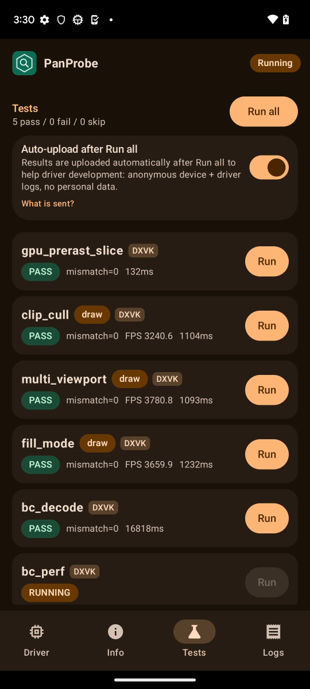
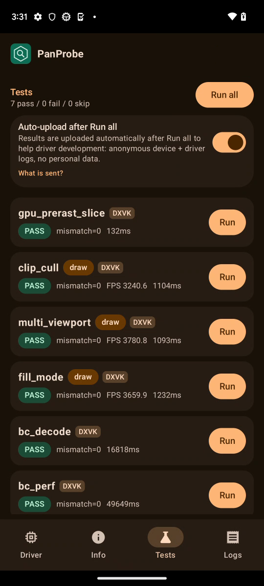
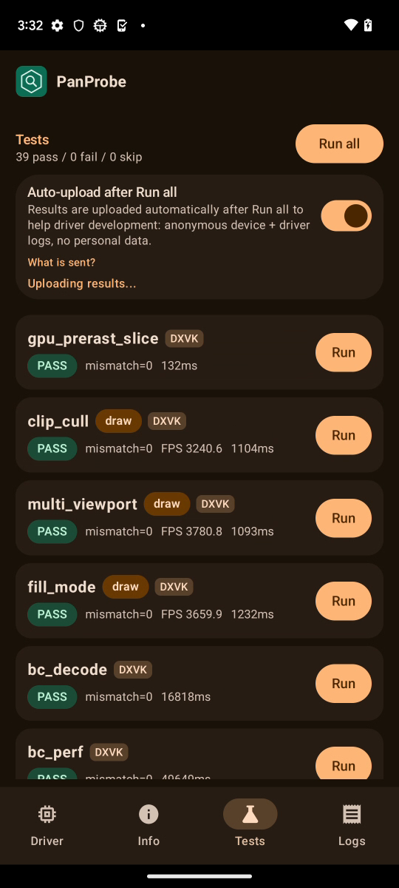

# FTL panther (Pixel 7, v10, Mali-G710) RC5-universal-110

AUTORUN DONE pass=39 fail=0 skip=0. Driver PanVK-kbase RC5-universal-110 (git-6cae57f893), so 5f217f70. gpu_id 0xa8620004 arch v10 model Mali-G710, API 33. No DEVICE_LOST, event=0x or fatal signals in logcat. Raw files in raw/ (the uploaded APK is not kept).

Screenshots (frames from the FTL video):   
