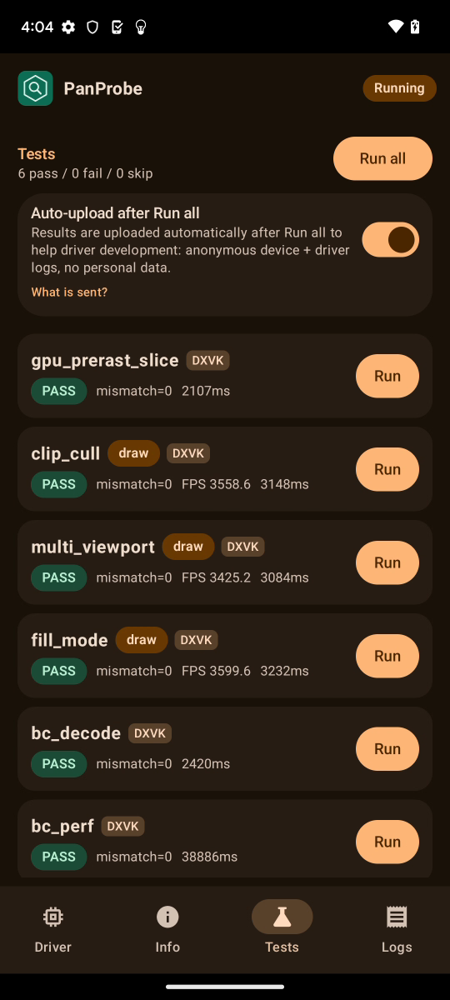
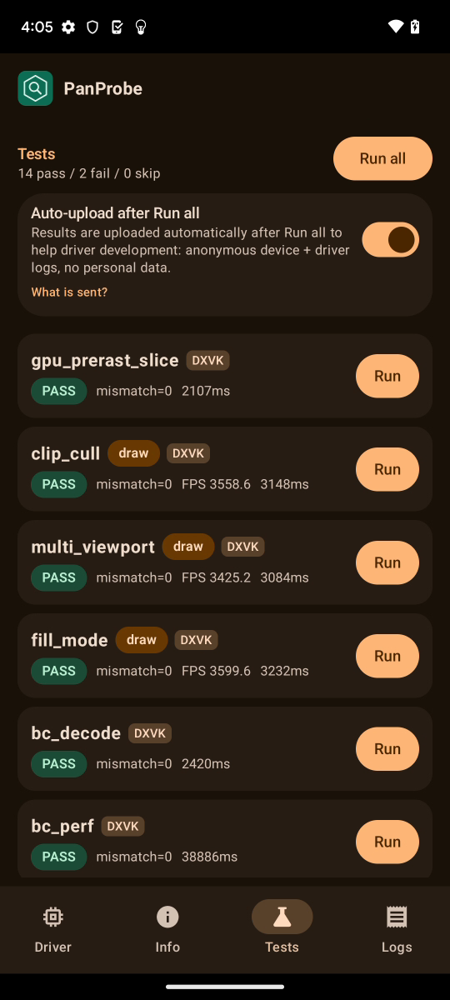
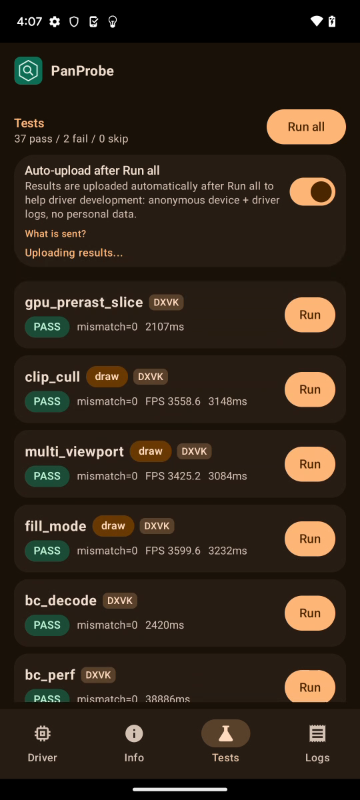

# FTL oriole (Pixel 6, v9, Mali-G78) RC5-universal-110

AUTORUN DONE pass=37 fail=2 skip=0. Driver PanVK-kbase RC5-universal-110 (git-6cae57f893), so 5f217f70. gpu_id 0x92020010 arch v9 model Mali-G78 (JM), API 33. First RC5 run on v9 hardware.

Failures:
- tess_perf: `FAIL Wait r=-4 line=253` after gs=1 L=4; kbase `JM atom 25/26/27 failed: event=0x60` (core_req 0x16 / 0x1) at 04:04:14.386. gs=0 configs and gs=1 L=1 ran with hashes matching other GPUs.
- large_draw: base_inst_direct / base_inst_windows / base_inst_fan_windows write wrong data (bad=174464 / 140002 / 449997); fan_indirect and fan_indexed_indirect write nothing (written=0).

Raw files in raw/ (the uploaded APK is not kept). Diagnosis pending.

Screenshots (frames from the FTL video):   
