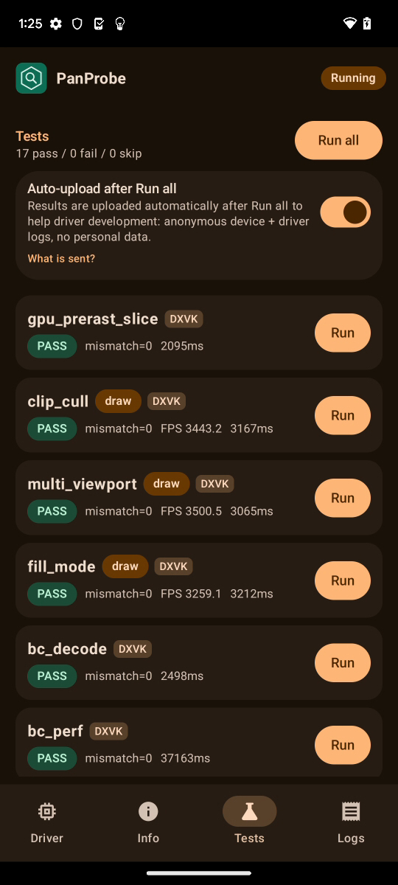
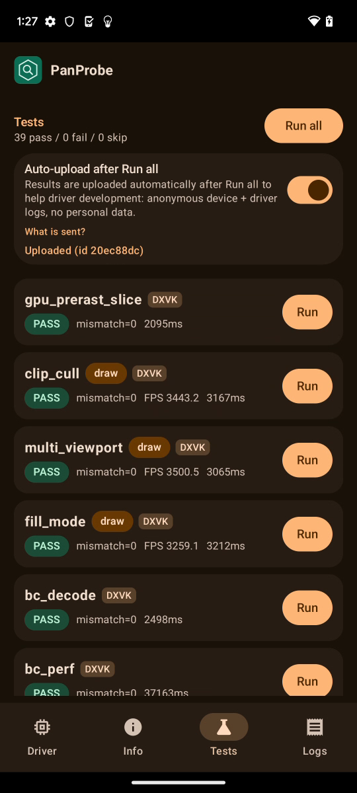

# FTL oriole (Pixel 6, v9, Mali-G78) RC5-universal-111

AUTORUN DONE pass=39 fail=0 skip=0. Driver PanVK-kbase RC5-universal-111 (git-0f470d21cf), so a06030fa. No DEVICE_LOST, event=0x or fatal signals.

Fix checks (jm-v7-wip 0090-0092):
- `panvk: v9 tiler heaps 2 x 512 MiB (GROW_ON_GPF)` logged.
- tess_perf gs=1 L=16 hash d4463b35 and gs=1 L=mix hash b34a251c, both equal to gs=0 (no OUT_OF_MEMORY).
- large_draw: every base_inst case bad=0; fan_indirect and fan_indexed_indirect 65534 written of 65534 generated.

Raw files in raw/ (the uploaded APK is not kept).

Screenshots (frames from the FTL video):   
