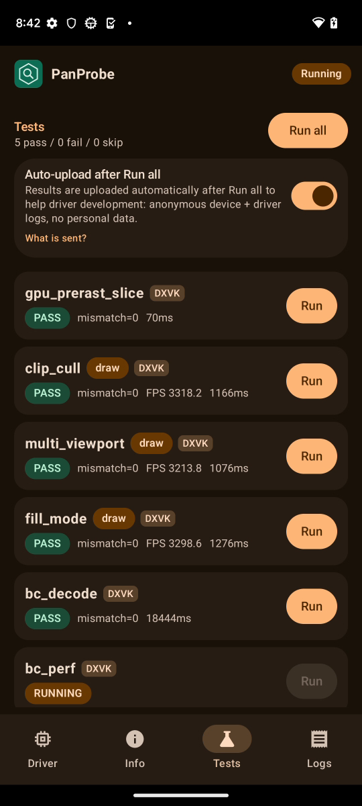
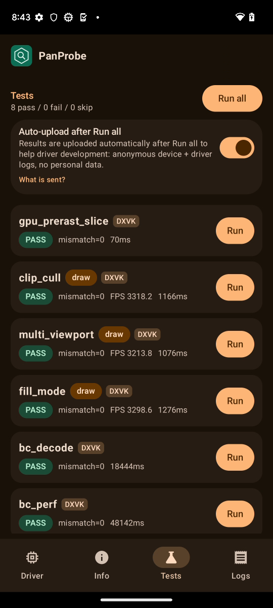
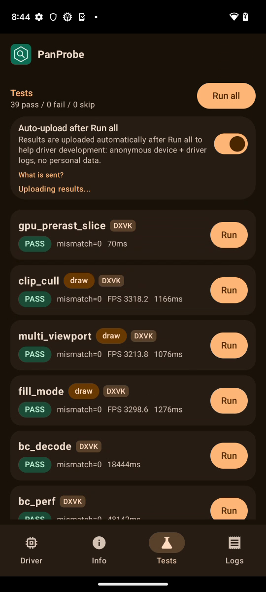

# FTL panther (Pixel 7, v10, Mali-G710) RC5-universal-112

AUTORUN DONE pass=39 fail=0 skip=0. Driver PanVK-kbase RC5-universal-112 (git-a1f95e1585), so 15fc5464. arch v10 model Mali-G710, API 33. No DEVICE_LOST, event=0x or fatal signals in logcat.

Regression check for csf-v11 223-229. v10 is the first arch where the CSF-only parts are active (smaller tiler heaps, cmd-pool auto-trim, TLS free, small utrace heap). No regression:
- The 224 smaller tiler heaps are in effect: `kbase: tiler heaps 4 initial / 400 max chunks of 1024 KiB` is logged 42 times (absent on 110). There is no tiler OOM, DEVICE_LOST or fault.
- Total test time is 171 s, the same as 110. tess_perf 48.2 s vs 48.2 s, bc_perf 48.1 s vs 49.6 s, large_draw 6.4 s vs 6.1 s.
- bc_decode took 18.4 s vs 16.8 s (+10%). It passes with mismatch 0 and logs the same driver messages as 110. Heavy background system activity (Android System Intelligence, Play Store) shows up in logcat during this test in both runs, so the gap is within FTL noise. Sub-second tests show large percentage swings because they last 0.1-0.4 s.

Per-test durationMs (112 vs 110 on the same device model):

| test | 112 | 110 | delta vs 110 |
|---|---|---|---|
| gpu_prerast_slice | 0.1s | 0.1s | -47% |
| clip_cull | 1.2s | 1.1s | +6% |
| multi_viewport | 1.1s | 1.1s | -2% |
| fill_mode | 1.3s | 1.2s | +4% |
| bc_decode | 18.4s | 16.8s | +10% |
| bc_perf | 48.1s | 49.6s | -3% |
| tess_perf | 48.2s | 48.2s | +0% |
| geometry | 1.4s | 1.3s | +2% |
| tessellation | 2.1s | 2.2s | -5% |
| xfb | 0.4s | 0.4s | -5% |
| pipeline_stats | 1.2s | 1.2s | +2% |
| vertex_stores | 0.2s | 0.1s | +4% |
| gs_viewport_depth | 0.2s | 0.3s | -28% |
| vs_viewport_index | 0.3s | 0.3s | -2% |
| depth_bounds | 0.2s | 0.2s | -20% |
| large_draw | 6.4s | 6.1s | +4% |
| vmr_secondary | 0.1s | 0.1s | -38% |
| tess_cond_state | 0.4s | 0.4s | -1% |
| bachata_reqs | 0.1s | 0.1s | +11% |
| bachata_exec | 0.1s | 0.1s | -26% |
| robustness2 | 0.1s | 0.1s | +7% |
| robust_image_access2 | 0.7s | 0.7s | -2% |
| blend | 0.1s | 0.1s | -14% |
| occlusion_query | 0.1s | 0.1s | -35% |
| descriptor_model | 0.1s | 0.1s | -39% |
| shader_arith | 0.1s | 0.1s | -15% |
| depth_stencil | 0.1s | 0.1s | -24% |
| sampler | 0.1s | 0.1s | +3% |
| draw_params | 0.1s | 0.1s | +17% |
| submit_stress | 30.1s | 30.1s | -0% |
| csf_event | 0.3s | 0.3s | -1% |
| gs_tess_primitive_id | 0.4s | 0.3s | +26% |
| bachata_storage_fmtless | 0.1s | 0.1s | -7% |
| bachata_dynamic_render | 0.1s | 0.1s | -33% |
| dxvk_reqs | 0.0s | 0.1s | -6% |
| vkd3d_reqs | 0.0s | 0.0s | +0% |
| vkd3d_heap | 0.3s | 0.3s | -9% |
| vkd3d_timeline | 0.2s | 0.3s | -15% |
| swapchain_lifecycle | 6.4s | 6.4s | -0% |
| total | 171s | 171s | -0% |

Raw files in raw/ (the uploaded APK is not kept).

Screenshots (frames from the FTL video):   
