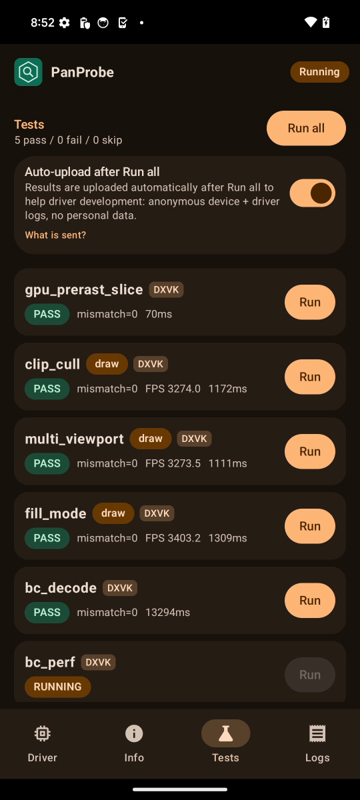
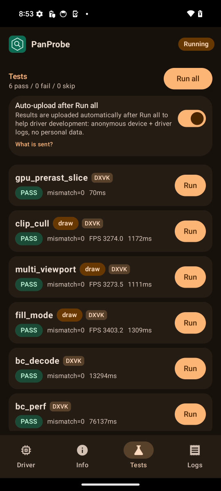
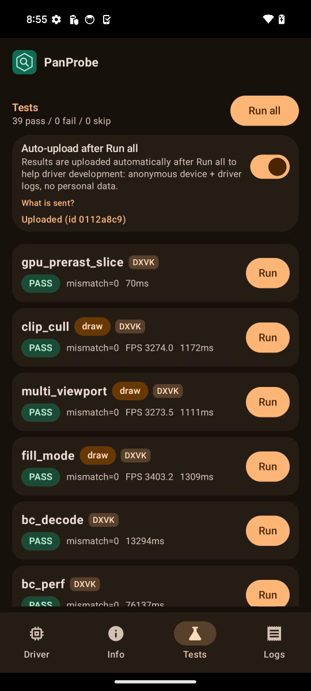

# FTL shiba (Pixel 8, v11, Mali-G715) RC5-universal-112

AUTORUN DONE pass=39 fail=0 skip=0. Driver PanVK-kbase RC5-universal-112 (git-a1f95e1585), so 15fc5464. arch v11 model Mali-G715, API 34. No DEVICE_LOST, event=0x or fatal signals in logcat.

Regression check for csf-v11 223-229. v11 is the target arch for these patches. No regression:
- The 224 smaller tiler heaps are in effect: `kbase: tiler heaps 4 initial / 400 max chunks of 1024 KiB` is logged 42 times. There is no tiler OOM, DEVICE_LOST or fault.
- Total test time is 193 s vs 247 s on 110 (-22%). Most of the difference is bc_perf (76 s vs 118 s) and bc_decode (13 s vs 19 s). The GPU-bound tess_perf case matches 110 (gs=0 L=16 612 ms vs 597 ms, same hash). bc_perf per-format GPU numbers move both ways (BC1 A_ms 0.59 vs 1.03, BC7 A_ms 0.72 vs 0.43), which looks like DVFS/run variance on the FTL unit. The 112 changes do not clearly cause the faster wall time, but there is no slowdown.

Per-test durationMs (112 vs 110 on the same device model):

| test | 112 | 110 | delta vs 110 |
|---|---|---|---|
| gpu_prerast_slice | 0.1s | 0.2s | -61% |
| clip_cull | 1.2s | 1.2s | -1% |
| multi_viewport | 1.1s | 1.1s | -2% |
| fill_mode | 1.3s | 1.4s | -3% |
| bc_decode | 13.3s | 19.1s | -30% |
| bc_perf | 76.1s | 117.9s | -35% |
| tess_perf | 44.6s | 48.1s | -7% |
| geometry | 1.5s | 1.6s | -10% |
| tessellation | 2.4s | 2.6s | -10% |
| xfb | 0.4s | 0.7s | -44% |
| pipeline_stats | 1.2s | 1.3s | -3% |
| vertex_stores | 0.1s | 0.2s | -47% |
| gs_viewport_depth | 0.2s | 0.4s | -41% |
| vs_viewport_index | 0.3s | 0.6s | -38% |
| depth_bounds | 0.1s | 0.2s | -31% |
| large_draw | 6.0s | 6.4s | -6% |
| vmr_secondary | 0.1s | 0.1s | -17% |
| tess_cond_state | 0.3s | 0.5s | -31% |
| bachata_reqs | 0.1s | 0.1s | -43% |
| bachata_exec | 0.1s | 0.1s | -17% |
| robustness2 | 0.1s | 0.1s | -6% |
| robust_image_access2 | 0.6s | 0.7s | -12% |
| blend | 0.1s | 0.1s | -39% |
| occlusion_query | 0.1s | 0.1s | -18% |
| descriptor_model | 0.1s | 0.1s | -39% |
| shader_arith | 0.1s | 0.2s | -37% |
| depth_stencil | 0.1s | 0.2s | -44% |
| sampler | 0.1s | 0.2s | -40% |
| draw_params | 0.1s | 0.2s | -44% |
| submit_stress | 30.1s | 30.1s | -0% |
| csf_event | 0.3s | 0.3s | -3% |
| gs_tess_primitive_id | 0.4s | 0.5s | -27% |
| bachata_storage_fmtless | 0.1s | 0.1s | -44% |
| bachata_dynamic_render | 0.1s | 0.1s | -33% |
| dxvk_reqs | 0.1s | 0.1s | -33% |
| vkd3d_reqs | 0.1s | 0.1s | -17% |
| vkd3d_heap | 0.3s | 0.4s | -12% |
| vkd3d_timeline | 0.3s | 0.3s | -22% |
| swapchain_lifecycle | 9.2s | 9.4s | -2% |
| total | 193s | 247s | -22% |

Raw files in raw/ (the uploaded APK is not kept).

Screenshots (frames from the FTL video):   
