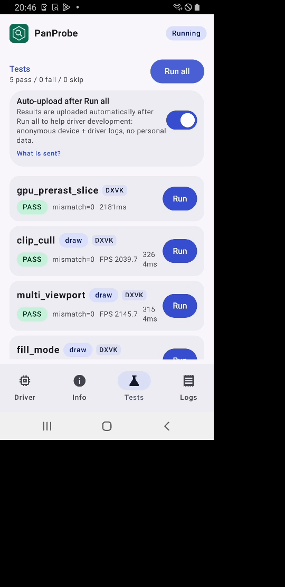
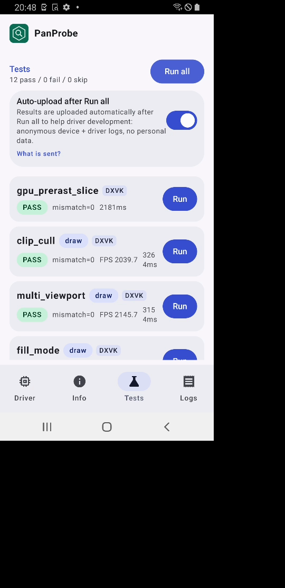
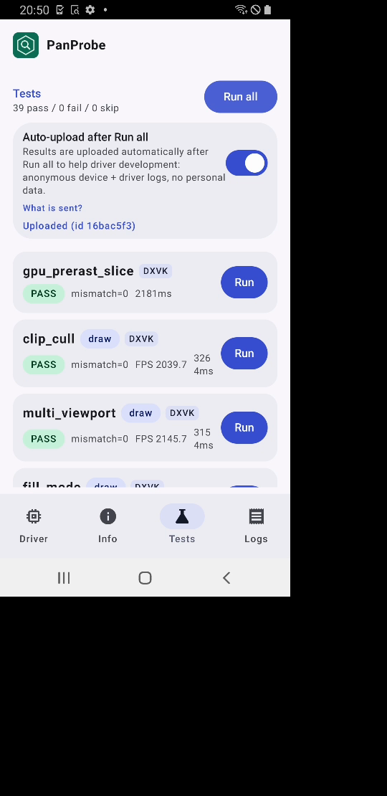

# FTL starlte (v6, Mali-G72) RC5-universal-112

AUTORUN DONE pass=39 fail=0 skip=0. Driver PanVK-kbase RC5-universal-112 (git-a1f95e1585), so 15fc5464. No DEVICE_LOST, event=0x or fatal signals in logcat.

Regression check for csf-v11 223-229 (FO4 memory fixes, shared code: atomic memory counters, BC copy stale check, cmd-pool auto-trim gated to v10+, opt-in budget knobs): no regression on v6 JM. Total test time 295 s vs 290 s (110) and 298 s (109), within run-to-run noise. bc_decode +0.4 s vs 110 matches 109 (2.6 s), so it is noise and not the BC stale check.

Per-test durationMs (112 vs 110 and 109 on the same device model):

| test | 112 | 110 | 109 | delta vs 110 |
|---|---|---|---|---|
| gpu_prerast_slice | 2.2s | 2.1s | 2.1s | +2% |
| clip_cull | 3.3s | 3.2s | 3.4s | +1% |
| multi_viewport | 3.2s | 3.1s | 3.2s | +0% |
| fill_mode | 4.1s | 3.9s | 4.1s | +6% |
| bc_decode | 2.6s | 2.2s | 2.6s | +21% |
| bc_perf | 37.9s | 36.1s | 40.5s | +5% |
| tess_perf | 98.4s | 98.8s | 98.6s | -0% |
| geometry | 3.7s | 3.6s | 3.7s | +3% |
| tessellation | 5.8s | 5.7s | 5.8s | +2% |
| xfb | 3.3s | 3.3s | 3.3s | +1% |
| pipeline_stats | 3.3s | 3.3s | 3.3s | +1% |
| vertex_stores | 2.2s | 2.1s | 2.2s | +2% |
| gs_viewport_depth | 2.2s | 2.1s | 2.2s | +3% |
| vs_viewport_index | 2.4s | 2.3s | 2.4s | +3% |
| depth_bounds | 2.4s | 2.3s | 2.4s | +5% |
| large_draw | 26.2s | 25.5s | 26.5s | +3% |
| vmr_secondary | 2.2s | 2.1s | 2.2s | +4% |
| tess_cond_state | 2.2s | 2.2s | 2.3s | +1% |
| bachata_reqs | 2.2s | 2.1s | 2.2s | +3% |
| bachata_exec | 2.2s | 2.1s | 2.2s | +2% |
| robustness2 | 2.2s | 2.1s | 2.2s | +2% |
| robust_image_access2 | 2.9s | 2.8s | 2.9s | +4% |
| blend | 2.2s | 2.2s | 2.2s | +1% |
| occlusion_query | 2.2s | 2.1s | 2.2s | +4% |
| descriptor_model | 2.2s | 2.1s | 2.2s | +4% |
| shader_arith | 2.2s | 2.2s | 2.2s | +1% |
| depth_stencil | 2.2s | 2.1s | 2.2s | +1% |
| sampler | 2.2s | 2.1s | 2.2s | +4% |
| draw_params | 2.2s | 2.1s | 2.2s | +2% |
| submit_stress | 32.1s | 32.1s | 32.1s | +0% |
| csf_event | 2.8s | 2.7s | 2.8s | +5% |
| gs_tess_primitive_id | 2.6s | 2.6s | 2.7s | +1% |
| bachata_storage_fmtless | 2.2s | 2.1s | 2.2s | +3% |
| bachata_dynamic_render | 2.1s | 2.1s | 2.2s | +1% |
| dxvk_reqs | 2.1s | 2.1s | 2.1s | +3% |
| vkd3d_reqs | 2.2s | 2.1s | 2.1s | +4% |
| vkd3d_heap | 2.5s | 2.4s | 2.5s | +5% |
| vkd3d_timeline | 2.3s | 2.2s | 2.3s | +3% |
| swapchain_lifecycle | 11.4s | 11.4s | 11.4s | +0% |
| total | 295s | 290s | 298s | +2% |

Raw files in raw/ (the uploaded APK is not kept).

Screenshots (frames from the FTL video):   
