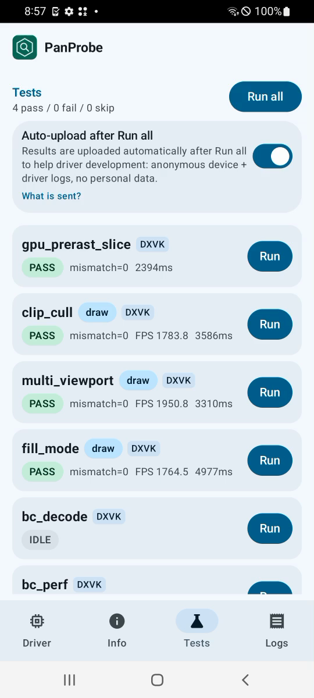
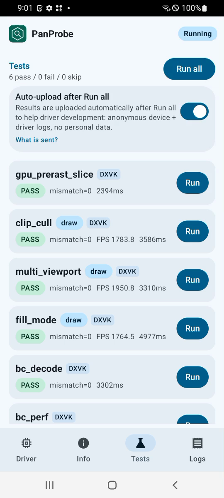
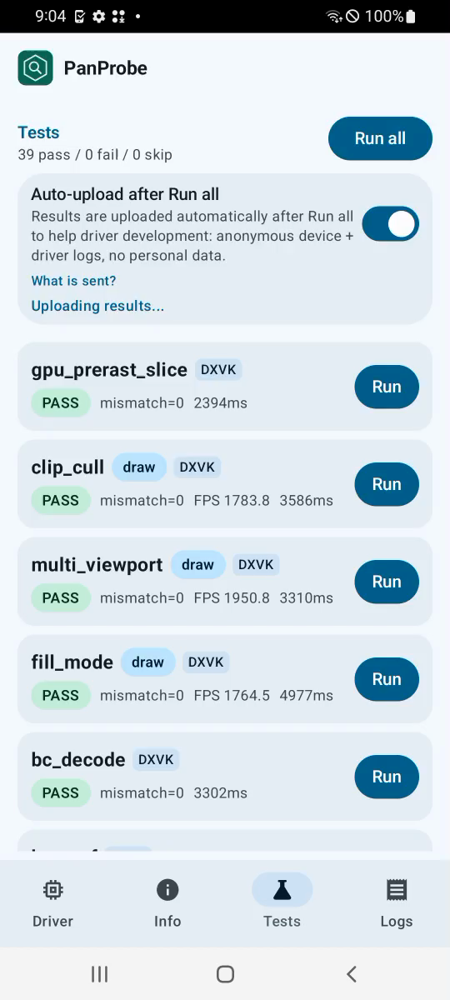

# FTL a31 (v7, Mali-G52 r1) RC5-universal-112

AUTORUN DONE pass=39 fail=0 skip=0. Driver PanVK-kbase RC5-universal-112 (git-a1f95e1585), so 15fc5464. gpu_id 0x74021000 arch v7. No DEVICE_LOST, event=0x or fatal signals in logcat.

Regression check for csf-v11 223-229: all tests pass, tess_perf hashes match 110/108 (d4463b35, b34a251c, cec55885, a03404c5). The driver messages in tess_perf (JM atom stride, JIT skipped, tess batch budget 32 MiB) are the same as in 110.

## Timing

Total 433 s vs 393 s (110) and 450 s (108). The heavy GPU tests are slower than 110: tess_perf 180 s vs 157 s, bc_perf 74 s vs 68 s, large_draw 29 s vs 23 s, tessellation 13.2 s vs 10.9 s. CPU-bound cases are flat (tess_perf L=ref 2.15 ms vs 2.23 ms, submit_stress and swapchain_lifecycle unchanged).

This looks like a slower GPU clock on the FTL unit, not a 112 code change:
- bc_perf GPU-timestamped plain sampling (A_ms, BC1_RGB_UNORM) is 2.98 ms on 108, 3.30 ms on 110 and 3.55 ms on 112. The slowdown is the same for every format and every path (A-E, upload). The slide between 108 and 110 happened without these patches.
- tess_perf gs=0 L=16: 5120 ms on 108, 5866 ms on 110, 7120 ms on 112. The ratio is the same at L=1/4/mix.
- On v7 JM, 112 only adds the 223 counters (a few atomics per private BO create/destroy). 224, 226, 227 and 228 are gated to v10+, 225's BC stale check is never set on JM, and the 229 knobs are opt-in. None of these touch shader or GPU work.

Per-test durationMs (112 vs 110 and 108 on the same device model):

| test | 112 | 110 | 108 | delta vs 110 |
|---|---|---|---|---|
| gpu_prerast_slice | 2.4s | 2.5s | 4.3s | -6% |
| clip_cull | 3.6s | 3.4s | 5.3s | +5% |
| multi_viewport | 3.3s | 3.2s | 5.2s | +2% |
| fill_mode | 5.0s | 4.6s | 6.6s | +9% |
| bc_decode | 3.3s | 3.3s | 5.2s | +1% |
| bc_perf | 74.2s | 67.8s | 67.0s | +9% |
| tess_perf | 179.9s | 157.3s | 139.5s | +14% |
| geometry | 4.2s | 4.2s | 6.1s | +1% |
| tessellation | 13.2s | 10.9s | 13.0s | +21% |
| xfb | 3.6s | 3.3s | 5.3s | +8% |
| pipeline_stats | 3.4s | 3.4s | 5.4s | -0% |
| vertex_stores | 2.2s | 2.2s | 4.2s | +3% |
| gs_viewport_depth | 2.2s | 2.2s | 4.2s | +0% |
| vs_viewport_index | 2.5s | 2.4s | 4.5s | +5% |
| depth_bounds | 2.4s | 2.4s | 4.4s | +1% |
| large_draw | 29.4s | 23.2s | 24.9s | +27% |
| vmr_secondary | 2.1s | 2.2s | 4.2s | -0% |
| tess_cond_state | 2.2s | 2.2s | 4.2s | +3% |
| bachata_reqs | 2.1s | 2.1s | 4.2s | +0% |
| bachata_exec | 2.2s | 2.2s | 4.2s | +1% |
| robustness2 | 2.2s | 2.2s | 4.1s | +2% |
| robust_image_access2 | 7.1s | 5.7s | 7.8s | +25% |
| blend | 2.2s | 2.2s | 4.2s | +1% |
| occlusion_query | 2.2s | 2.1s | 4.2s | +1% |
| descriptor_model | 2.2s | 2.2s | 4.2s | +0% |
| shader_arith | 2.2s | 2.2s | 4.2s | +0% |
| depth_stencil | 2.2s | 2.2s | 4.2s | +1% |
| sampler | 2.2s | 2.2s | 4.2s | +2% |
| draw_params | 2.2s | 2.2s | 4.2s | -1% |
| submit_stress | 32.1s | 32.1s | 34.1s | +0% |
| csf_event | 2.6s | 2.6s | 4.6s | +0% |
| gs_tess_primitive_id | 2.6s | 2.6s | 4.7s | -1% |
| bachata_storage_fmtless | 2.2s | 2.2s | 4.2s | +0% |
| bachata_dynamic_render | 2.2s | 2.1s | 4.2s | +0% |
| dxvk_reqs | 2.1s | 2.1s | 2.1s | -0% |
| vkd3d_reqs | 2.1s | 2.1s | 2.1s | +0% |
| vkd3d_heap | 2.4s | 2.4s | 10.5s | +2% |
| vkd3d_timeline | 2.3s | 2.3s | 4.3s | -0% |
| swapchain_lifecycle | 14.5s | 14.6s | 15.9s | -1% |
| total | 433s | 393s | 450s | +10% |

Raw files in raw/ (the uploaded APK is not kept).

Screenshots (frames from the FTL video):   
