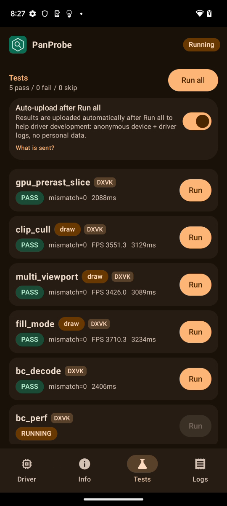
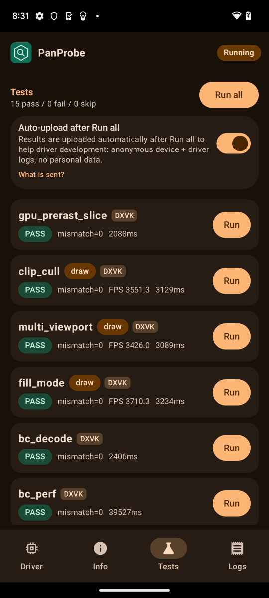
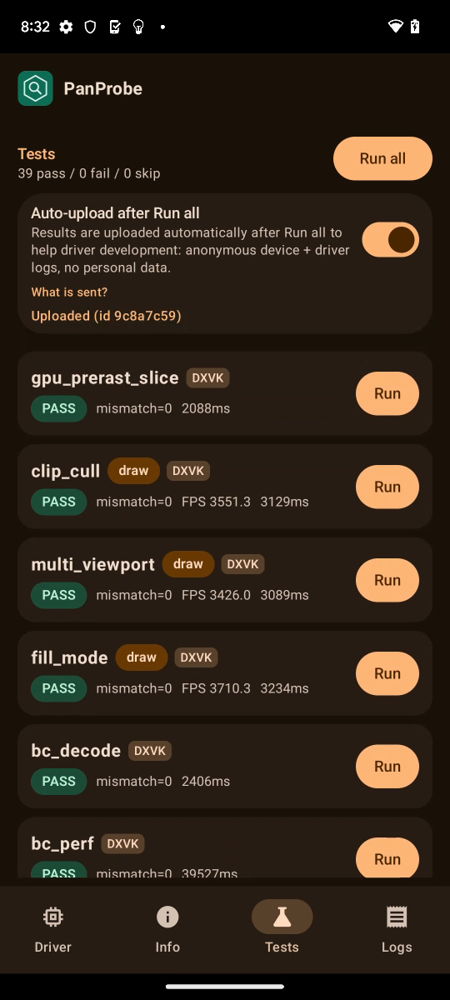

# FTL oriole (Pixel 6, v9, Mali-G78) RC5-universal-112

AUTORUN DONE pass=39 fail=0 skip=0. Driver PanVK-kbase RC5-universal-112 (git-a1f95e1585), so 15fc5464. No DEVICE_LOST, event=0x or fatal signals in logcat.

Regression check for csf-v11 223-229: no regression on v9. Total test time 302 s vs 299 s (111).

The 111 fixes (jm-v7-wip 0090-0092) still hold:
- `panvk: v9 tiler heaps 2 x 512 MiB (GROW_ON_GPF)` is logged.
- tess_perf gs=1 L=16 hash d4463b35 and L=mix hash b34a251c, equal to gs=0. GPU times match 111: gs=0 L=16 902 ms vs 892 ms, gs=1 L=16 3786 ms vs 3836 ms.
- large_draw: every base_inst case is bad=0. fan_indirect and fan_indexed_indirect wrote 65534 of 65534.

bc_perf took +2.3 s of wall time, but its GPU numbers match 111 (BC1 A_ms 0.307 vs 0.304, upload_gpu_ms 48.36 vs 48.37), so the difference is noise.

Per-test durationMs (112 vs 111 and 110 on the same device model; 110 had the tess_perf/large_draw failures fixed in 111):

| test | 112 | 111 | 110 | delta vs 111 |
|---|---|---|---|---|
| gpu_prerast_slice | 2.1s | 2.1s | 2.1s | -0% |
| clip_cull | 3.1s | 3.2s | 3.1s | -1% |
| multi_viewport | 3.1s | 3.1s | 3.1s | +1% |
| fill_mode | 3.2s | 3.2s | 3.2s | +1% |
| bc_decode | 2.4s | 2.5s | 2.4s | -4% |
| bc_perf | 39.5s | 37.2s | 38.9s | +6% |
| tess_perf | 94.0s | 94.3s | 20.5s FAIL | -0% |
| geometry | 3.5s | 3.4s | 3.5s | +2% |
| tessellation | 6.3s | 6.2s | 6.3s | +1% |
| xfb | 2.4s | 2.4s | 2.4s | +0% |
| pipeline_stats | 3.3s | 3.3s | 3.3s | +1% |
| vertex_stores | 2.2s | 2.2s | 2.2s | +1% |
| gs_viewport_depth | 2.3s | 2.3s | 2.3s | -2% |
| vs_viewport_index | 2.3s | 2.3s | 2.3s | +0% |
| depth_bounds | 2.4s | 2.4s | 2.4s | +0% |
| large_draw | 34.5s | 34.2s | 33.9s FAIL | +1% |
| vmr_secondary | 2.1s | 2.1s | 2.1s | +2% |
| tess_cond_state | 2.3s | 2.3s | 2.2s | -1% |
| bachata_reqs | 2.3s | 2.3s | 2.2s | +0% |
| bachata_exec | 2.1s | 2.2s | 2.1s | -0% |
| robustness2 | 2.2s | 2.1s | 2.2s | +1% |
| robust_image_access2 | 10.1s | 10.1s | 10.1s | +1% |
| blend | 2.2s | 2.1s | 2.2s | +2% |
| occlusion_query | 2.1s | 2.1s | 2.1s | -1% |
| descriptor_model | 2.2s | 2.2s | 2.1s | -3% |
| shader_arith | 2.2s | 2.2s | 2.2s | -0% |
| depth_stencil | 2.2s | 2.2s | 2.1s | +1% |
| sampler | 2.2s | 2.2s | 2.1s | +0% |
| draw_params | 2.2s | 2.2s | 2.2s | -2% |
| submit_stress | 32.1s | 32.1s | 32.1s | +0% |
| csf_event | 2.8s | 2.7s | 2.8s | +2% |
| gs_tess_primitive_id | 2.5s | 2.5s | 2.4s | +1% |
| bachata_storage_fmtless | 2.1s | 2.2s | 2.1s | -1% |
| bachata_dynamic_render | 2.1s | 2.1s | 2.1s | -0% |
| dxvk_reqs | 2.1s | 2.1s | 2.1s | -1% |
| vkd3d_reqs | 2.1s | 2.1s | 2.1s | -2% |
| vkd3d_heap | 2.4s | 2.4s | 2.3s | +0% |
| vkd3d_timeline | 2.3s | 2.3s | 2.2s | +2% |
| swapchain_lifecycle | 8.3s | 8.4s | 8.4s | -1% |
| total | 302s | 299s | 227s | +1% |

Raw files in raw/ (the uploaded APK is not kept).

Screenshots (frames from the FTL video):   
