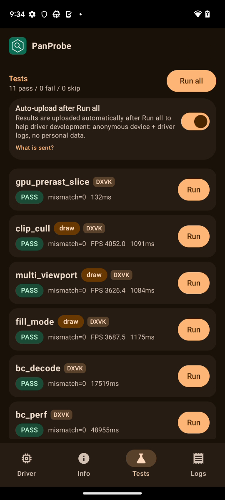
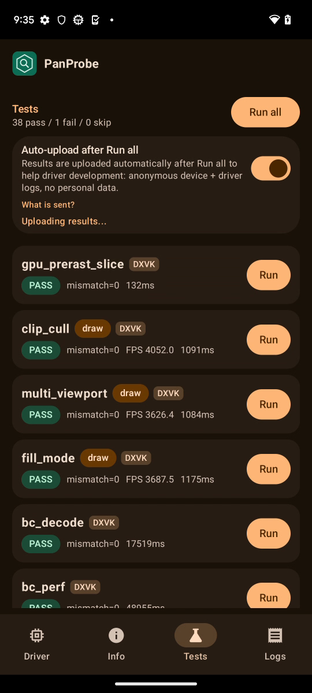

# FTL panther (Pixel 7, v10, Mali-G710) RC5-universal-113

AUTORUN DONE pass=38 fail=1 skip=0. Driver PanVK-kbase RC5-universal-113 (git-6b925d3100), so 48a548e4. arch v10 model Mali-G710 MC7 (gpu_id 0xa8620004), API 33. No DEVICE_LOST, event=0x or fatal signals in logcat.

## REGRESSION: gs_tess_primitive_id FAILS again (same as shiba 113, passed on 112)

This is the same failure as on shiba, so it reproduces on v10 and v11. The 24-prim direct/indirect cases pass. The three 600-patch GPU-chunk cases fail with scattered patch IDs:

```
FAIL chunk ids bad=307 first=143 0 0 446
FAIL chunk-replay ids bad=322 first=116 117 114 118
FAIL indirect-chunk ids bad=323 first=287 432 435 287
RESULT FAIL
```

The test was preceded by `panvk: device TLS 4096 B/thread x 2048 threads x 25 core IDs (7 cores, mask 0x1110055) = 200 MiB of VA, 56 MiB backed`. Bad counts and IDs differ between the same command buffer submitted twice, and there is no GPU fault. That points to threads sharing stack memory, which fits the 230 aliased TLS slots (absent cores alias slab 0) being used by cores that are actually running. Only 230/231 changed between 112 and 113, and both are v10+ only. Prime suspect: 230 PANVK_TLS_SPARSE. See shiba results.md in 2026-10-25-ftl-v11-shiba-rc5u-113. The v7/v6/v9 runs are the control. Patches were not changed.

tess_perf output hashes are identical to 112 for all 18 BENCH lines (4807f3f5, a03404c5, cec55885, d4463b35, b34a251c).

## TLS / 231

Every "panvk: device TLS" line in logcat (count, line):

```
7  panvk: device TLS 4096 B/thread x 2048 threads x 25 core IDs (7 cores, mask 0x1110055) = 200 MiB of VA, 56 MiB backed
2  panvk: device TLS 2048 B/thread x 2048 threads x 25 core IDs (7 cores, mask 0x1110055) = 100 MiB of VA, 28 MiB backed
2  panvk: device TLS 256 B/thread x 2048 threads x 25 core IDs (7 cores, mask 0x1110055) = 12 MiB of VA, 3 MiB backed
```

That is 7 cores, core-ID range 0-24 (cores 0, 2, 4, 6, 16, 20, 24), and 4096/2048/256 B per thread. This is the same core mask that FTL shiba reports. `kbase: tiler heaps 4 initial / 400 max chunks of 1024 KiB` is logged 42 times, as on 112.

## Timing

Total 169 s vs 171 s on 112 (-1%). tess_perf takes 47.9 s vs 48.2 s, and every BENCH case is within 3% (gs=0 L=16 702 ms vs 701 ms, gs=1 L=16 1107 ms vs 1134 ms). bc_perf takes 49.0 s vs 48.1 s and bc_decode 17.5 s vs 18.4 s. Sub-second tests swing by large percentages because they last 0.1-0.3 s. No perf change from 113.

Per-test durationMs (113 vs 112 on the same device model):

| test | 113 | 112 | delta vs 112 |
|---|---|---|---|
| gpu_prerast_slice | 0.1s | 0.1s | +89% |
| clip_cull | 1.1s | 1.2s | -6% |
| multi_viewport | 1.1s | 1.1s | +1% |
| fill_mode | 1.2s | 1.3s | -8% |
| bc_decode | 17.5s | 18.4s | -5% |
| bc_perf | 49.0s | 48.1s | +2% |
| tess_perf | 47.9s | 48.2s | -1% |
| geometry | 1.4s | 1.4s | +0% |
| tessellation | 2.1s | 2.1s | -2% |
| xfb | 0.3s | 0.4s | -32% |
| pipeline_stats | 1.2s | 1.2s | -2% |
| vertex_stores | 0.1s | 0.2s | -8% |
| gs_viewport_depth | 0.2s | 0.2s | +11% |
| vs_viewport_index | 0.2s | 0.3s | -33% |
| depth_bounds | 0.2s | 0.2s | +4% |
| large_draw | 6.2s | 6.4s | -4% |
| vmr_secondary | 0.1s | 0.1s | +18% |
| tess_cond_state | 0.3s | 0.4s | -24% |
| bachata_reqs | 0.1s | 0.1s | -3% |
| bachata_exec | 0.1s | 0.1s | +34% |
| robustness2 | 0.1s | 0.1s | +41% |
| robust_image_access2 | 0.7s | 0.7s | +6% |
| blend | 0.1s | 0.1s | +67% |
| occlusion_query | 0.1s | 0.1s | +32% |
| descriptor_model | 0.1s | 0.1s | +33% |
| shader_arith | 0.1s | 0.1s | +25% |
| depth_stencil | 0.1s | 0.1s | -12% |
| sampler | 0.1s | 0.1s | -2% |
| draw_params | 0.1s | 0.1s | -5% |
| submit_stress | 30.1s | 30.1s | +0% |
| csf_event | 0.3s | 0.3s | -2% |
| gs_tess_primitive_id | 0.3s | 0.4s | -31% |
| bachata_storage_fmtless | 0.1s | 0.1s | +14% |
| bachata_dynamic_render | 0.1s | 0.1s | +15% |
| dxvk_reqs | 0.1s | 0.0s | +17% |
| vkd3d_reqs | 0.1s | 0.0s | +39% |
| vkd3d_heap | 0.2s | 0.3s | -27% |
| vkd3d_timeline | 0.3s | 0.2s | +19% |
| swapchain_lifecycle | 6.3s | 6.4s | -1% |
| total | 169s | 171s | -1% |

Raw files in raw/ (the uploaded APK is not kept).

Screenshots (frames from the FTL video):   
