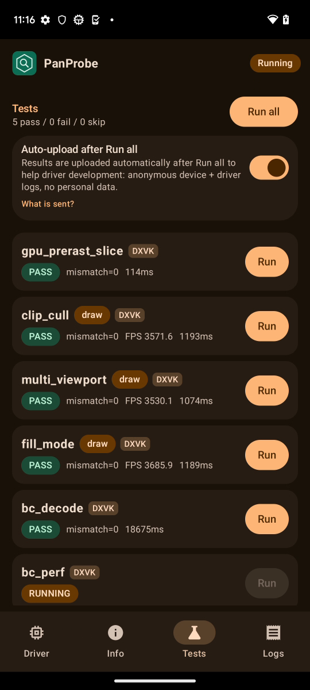
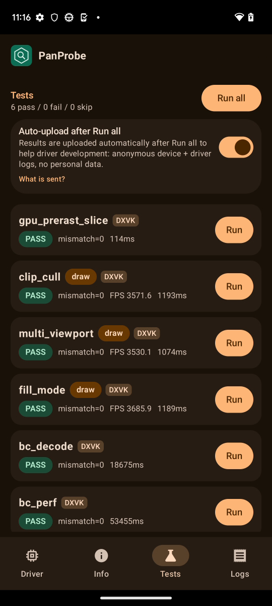
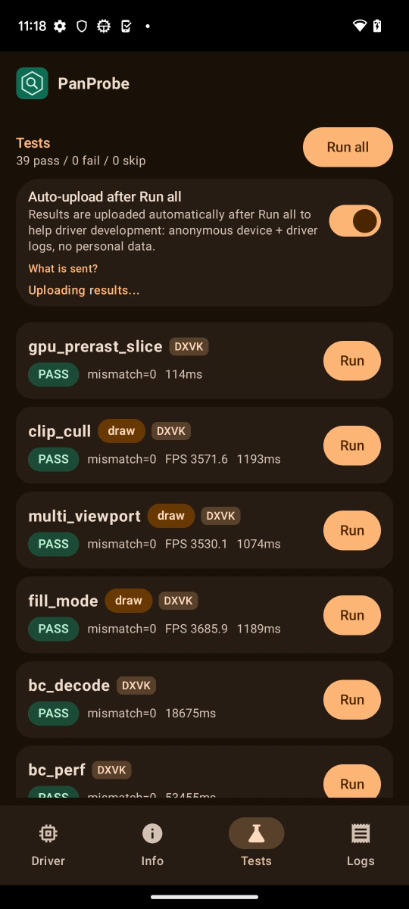

# FTL panther (Pixel 7, v10, Mali-G710) RC5-universal-114

AUTORUN DONE pass=39 fail=0 skip=0. `PANPROBE_RESULT driver=PanVK-kbase RC5-universal-114 (Mesa 26.3.0-devel (git-d324a2699e)) pass=39 fail=0 skip=0`. The .so is 57018130, arch v10, Mali-G710 (gpu_id 0xa8620004), API 33. FTL outcome: Passed.

## gs_tess_primitive_id: fixed (FAIL on 113, csf-v11 232)

```
CASE direct PASS / direct-replay PASS / indirect PASS / indirect-replay PASS
CASE chunk PASS / chunk-replay PASS / indirect-chunk PASS
RESULT PASS
```

113 had `FAIL chunk ids bad=307`, `chunk-replay bad=322` and `indirect-chunk bad=323`.

tess_perf: all 18 BENCH hashes are identical to 112 (4807f3f5, a03404c5, cec55885, d4463b35, b34a251c). gs=0 L=16 takes 706 ms (113: 702, 112: 701) and gs=1 L=16 takes 1151 ms (113: 1107, 112: 1134).

## TLS

Every "panvk: device TLS" line in logcat (count, line). These are the same as on 113, because 232 changes only the stride the TSDs carry, not the BOs:

```
7  panvk: device TLS 4096 B/thread x 2048 threads x 25 core IDs (7 cores, mask 0x1110055) = 200 MiB of VA, 56 MiB backed
2  panvk: device TLS 2048 B/thread x 2048 threads x 25 core IDs (7 cores, mask 0x1110055) = 100 MiB of VA, 28 MiB backed
2  panvk: device TLS 256 B/thread x 2048 threads x 25 core IDs (7 cores, mask 0x1110055) = 12 MiB of VA, 3 MiB backed
```

The sparse TLS stays on (`PANVK_TLS_SPARSE=1` default), so the 4096 B/thread case backs 56 MiB instead of 200 MiB (7 of 25 core-ID slabs). No DEVICE_LOST, event=0x or Fatal signal lines appear in logcat.

## Why 113 failed and 114 passes

In 230's sparse BO, each core-ID slot is THREAD_TLS_ALLOC x (the BO's per-thread size) wide, and the slots of absent cores alias slab 0. The hardware places core c's stacks at c x THREAD_TLS_ALLOC x (the stack size in the job's TSD). On 113, per-job TSDs (dispatch, precomp, and the gpu_prerast VS/GS/TCS compute jobs) carried their own shader's smaller stack size, so present cores landed in absent-core slots (which are slab 0) and threads shared stacks. 232 gives every TSD the BO's stride: the command buffer descriptor gets the BO's per-thread size, and per-job TSDs copy word 0 (TLS Size) along with the pointer. Shrink and 231 played no part: the 113 gs_tess process created one BO and lasted 0.25 s.

## Timing (ms from the logcat RESULT lines)

| test | 114 | 113 | 112 | delta vs 112 |
|---|---|---|---|---|
| gpu_prerast_slice | 0.1s | 0.1s | 0.1s | +63% |
| clip_cull | 1.2s | 1.1s | 1.2s | +2% |
| multi_viewport | 1.1s | 1.1s | 1.1s | +0% |
| fill_mode | 1.2s | 1.2s | 1.3s | -7% |
| bc_decode | 18.7s | 17.5s | 18.4s | +1% |
| bc_perf | 53.5s | 49.0s | 48.1s | +11% |
| tess_perf | 48.2s | 47.9s | 48.2s | +0% |
| geometry | 1.4s | 1.4s | 1.4s | +4% |
| tessellation | 2.1s | 2.1s | 2.1s | +0% |
| xfb | 0.3s | 0.3s | 0.4s | -15% |
| pipeline_stats | 1.2s | 1.2s | 1.2s | -2% |
| vertex_stores | 0.2s | 0.1s | 0.2s | +3% |
| gs_viewport_depth | 0.2s | 0.2s | 0.2s | +3% |
| vs_viewport_index | 0.3s | 0.2s | 0.3s | -21% |
| depth_bounds | 0.2s | 0.2s | 0.2s | +12% |
| large_draw | 6.2s | 6.2s | 6.4s | -3% |
| vmr_secondary | 0.1s | 0.1s | 0.1s | -5% |
| tess_cond_state | 0.3s | 0.3s | 0.4s | -28% |
| bachata_reqs | 0.1s | 0.1s | 0.1s | +32% |
| bachata_exec | 0.1s | 0.1s | 0.1s | +34% |
| robustness2 | 0.1s | 0.1s | 0.1s | -3% |
| robust_image_access2 | 0.7s | 0.7s | 0.7s | +1% |
| blend | 0.1s | 0.1s | 0.1s | +1% |
| occlusion_query | 0.1s | 0.1s | 0.1s | +20% |
| descriptor_model | 0.1s | 0.1s | 0.1s | +29% |
| shader_arith | 0.1s | 0.1s | 0.1s | +18% |
| depth_stencil | 0.1s | 0.1s | 0.1s | +5% |
| sampler | 0.1s | 0.1s | 0.1s | -4% |
| draw_params | 0.2s | 0.1s | 0.1s | +9% |
| submit_stress | 30.1s | 30.1s | 30.1s | +0% |
| csf_event | 0.3s | 0.3s | 0.3s | +13% |
| gs_tess_primitive_id | 0.2s | 0.3s | 0.4s | -35% |
| bachata_storage_fmtless | 0.1s | 0.1s | 0.1s | +30% |
| bachata_dynamic_render | 0.1s | 0.1s | 0.1s | +10% |
| dxvk_reqs | 0.1s | 0.1s | 0.0s | +38% |
| vkd3d_reqs | 0.1s | 0.1s | 0.0s | +43% |
| vkd3d_heap | 0.2s | 0.2s | 0.3s | -33% |
| vkd3d_timeline | 0.3s | 0.3s | 0.2s | +11% |
| swapchain_lifecycle | 6.3s | 6.3s | 6.4s | -1% |
| total | 175s | 169s | 170s | +3% |

bc_perf is +11% here and -10% on shiba 114. It is run-to-run variance, and 232 does not touch BC. tess_perf is flat.

Raw files are in raw/ (the uploaded APK is not kept).

Screenshots (frames from the FTL video):   
