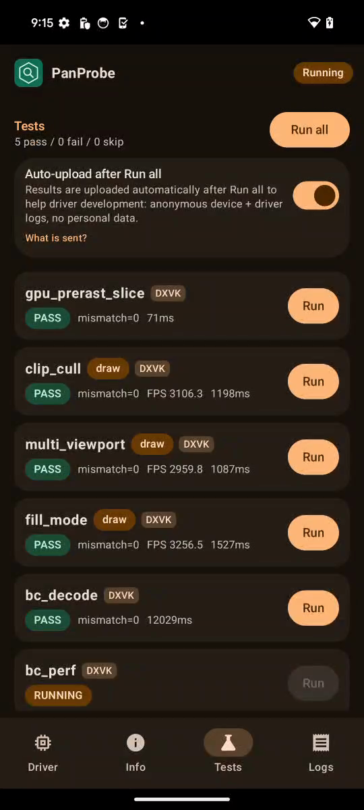
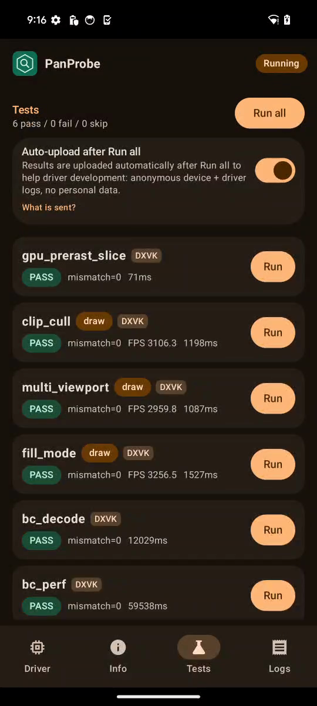
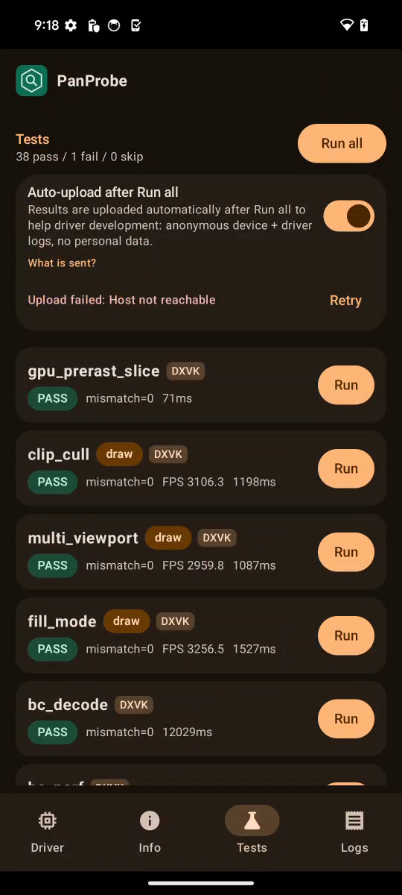

# FTL shiba (Pixel 8, v11, Mali-G715) RC5-universal-113

AUTORUN DONE pass=38 fail=1 skip=0. Driver PanVK-kbase RC5-universal-113 (git-6b925d3100), so 48a548e4. arch v11 model Mali-G715, API 34. No DEVICE_LOST, event=0x or fatal signals in logcat.

## REGRESSION: gs_tess_primitive_id FAILS (passed on 112 and on every earlier FTL run)

The three 600-patch cases that go through the GPU prerast chunk path fail. The small direct/indirect cases (24 prims) pass:

```
CASE direct PASS / direct-replay PASS / indirect PASS / indirect-replay PASS
FAIL chunk ids bad=347 first=114 0 0 0
FAIL chunk-replay ids bad=261 first=114 0 0 0
FAIL indirect-chunk ids bad=306 first=0 114 0 0
RESULT FAIL
```

Every patch should get exactly 6 GS invocations. The HIST lines show 0, 1, 5, 7, 8, 12 and 13 per patch instead, and the failure counts differ between the same command buffer submitted twice (chunk 347 vs chunk-replay 261). That looks like a data race, not a deterministic wrong formula. There is no GPU fault. The same test passed on 112 on this device model, and `FAIL chunk` has never shown up in any committed CSF/FTL run (it only appears in the 2026-10-21 a06 v7 dev builds).

The one thing that changed in this process is the new device TLS line. It is logged right before the first draw, after the gpu_prerast arenas:

```
panvk: device TLS 4096 B/thread x 2048 threads x 25 core IDs (7 cores, mask 0x1110055) = 200 MiB of VA, 56 MiB backed
```

230 backs only the 7 present cores' slabs, and the absent slots alias slab 0. If a shader core writes TLS at a core-ID slot the mask says is absent, or the hardware indexes TLS in a way that differs from the shader-present mask, those threads share slab 0 with core 0. The stacks then silently corrupt each other, with no fault. The 4096 B/thread gpu_prerast compute stack that the chunk path uses fits that pattern. **Suspect: the 230 sparse-TLS core-layout assumption is wrong on v11 (or the chunk path's TLS is used while aliased).** 112 used the fully backed TLS BO here. A clean A/B test would be the same APK with PANVK_TLS_SPARSE=0 (and PANVK_TLS_SHRINK_MS=0). Patches were not changed in this run.

tess_perf output hashes are identical to 112 for all 18 BENCH lines (4807f3f5, a03404c5, cec55885, d4463b35, b34a251c, for default and legacy opts, gs=0 and gs=1). tessellation, tess_cond_state and the other tess/GS tests pass. So the corruption is limited to what the 600-patch GPU chunk path writes to its stack, or it does not change the rendered image in tess_perf.

## TLS / 231

Every "panvk: device TLS" line in logcat (count, line):

```
7  panvk: device TLS 4096 B/thread x 2048 threads x 25 core IDs (7 cores, mask 0x1110055) = 200 MiB of VA, 56 MiB backed
2  panvk: device TLS 2048 B/thread x 2048 threads x 25 core IDs (7 cores, mask 0x1110055) = 100 MiB of VA, 28 MiB backed
2  panvk: device TLS 256 B/thread x 2048 threads x 25 core IDs (7 cores, mask 0x1110055) = 12 MiB of VA, 3 MiB backed
```

That is 7 cores, core-ID range 0-24 (mask 0x1110055 = cores 0, 2, 4, 6, 16, 20, 24), and 4096/2048/256 B per thread. The 4096 B case backs 56 MiB instead of 200 MiB. The 224 tiler heaps line is unchanged (`kbase: tiler heaps 4 initial / 400 max chunks of 1024 KiB`, 42 times). The panvk.tls.* and panvk.cmd.pool.autotrim* properties are only probed (defaults).

## Timing

Total 178 s vs 193 s on 112 (-8%). Most of that is bc_perf (59.5 s vs 76.1 s) and bc_decode (12.0 s vs 13.3 s), which already moved run-to-run between 110 and 112. tess_perf takes 47.5 s vs 44.6 s (+6%): gs=0 L=16 738 ms vs 612 ms and gs=1 L=16 1256 ms vs 1005 ms, but gs=0 L=4 is 149 ms vs 160 ms and L=mix is 601 ms vs 612 ms. Because the mix moves both ways, this looks like DVFS noise rather than a TLS cost, but the L=16 slowdown should be rechecked once the failure is resolved.

Per-test durationMs (113 vs 112 on the same device model):

| test | 113 | 112 | delta vs 112 |
|---|---|---|---|
| gpu_prerast_slice | 0.1s | 0.1s | +1% |
| clip_cull | 1.2s | 1.2s | +2% |
| multi_viewport | 1.1s | 1.1s | -2% |
| fill_mode | 1.5s | 1.3s | +17% |
| bc_decode | 12.0s | 13.3s | -10% |
| bc_perf | 59.5s | 76.1s | -22% |
| tess_perf | 47.5s | 44.6s | +6% |
| geometry | 1.5s | 1.5s | +4% |
| tessellation | 2.2s | 2.4s | -8% |
| xfb | 0.3s | 0.4s | -30% |
| pipeline_stats | 1.2s | 1.2s | -3% |
| vertex_stores | 0.1s | 0.1s | +1% |
| gs_viewport_depth | 0.3s | 0.2s | +24% |
| vs_viewport_index | 0.2s | 0.3s | -30% |
| depth_bounds | 0.2s | 0.1s | +10% |
| large_draw | 6.3s | 6.0s | +4% |
| vmr_secondary | 0.1s | 0.1s | -7% |
| tess_cond_state | 0.2s | 0.3s | -32% |
| bachata_reqs | 0.1s | 0.1s | +10% |
| bachata_exec | 0.1s | 0.1s | -11% |
| robustness2 | 0.1s | 0.1s | -10% |
| robust_image_access2 | 0.6s | 0.6s | -3% |
| blend | 0.1s | 0.1s | +10% |
| occlusion_query | 0.1s | 0.1s | -36% |
| descriptor_model | 0.1s | 0.1s | -21% |
| shader_arith | 0.1s | 0.1s | +2% |
| depth_stencil | 0.1s | 0.1s | -3% |
| sampler | 0.1s | 0.1s | -6% |
| draw_params | 0.2s | 0.1s | +37% |
| submit_stress | 30.1s | 30.1s | +0% |
| csf_event | 0.3s | 0.3s | -5% |
| gs_tess_primitive_id | 0.2s | 0.4s | -37% |
| bachata_storage_fmtless | 0.1s | 0.1s | +24% |
| bachata_dynamic_render | 0.1s | 0.1s | +8% |
| dxvk_reqs | 0.1s | 0.1s | +47% |
| vkd3d_reqs | 0.1s | 0.1s | +15% |
| vkd3d_heap | 0.3s | 0.3s | -11% |
| vkd3d_timeline | 0.3s | 0.3s | -1% |
| swapchain_lifecycle | 9.2s | 9.2s | +0% |
| total | 178s | 193s | -8% |

Raw files in raw/ (the uploaded APK is not kept).

Screenshots (frames from the FTL video):   
