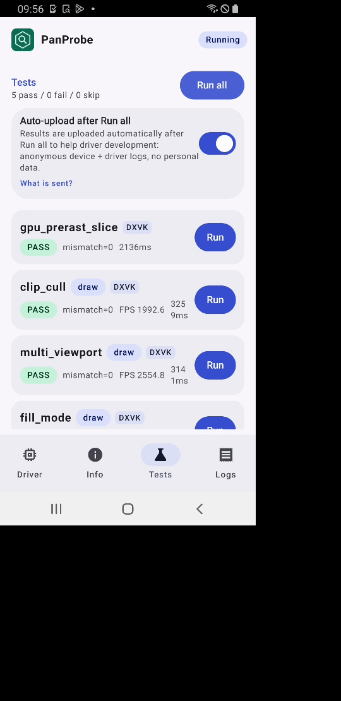
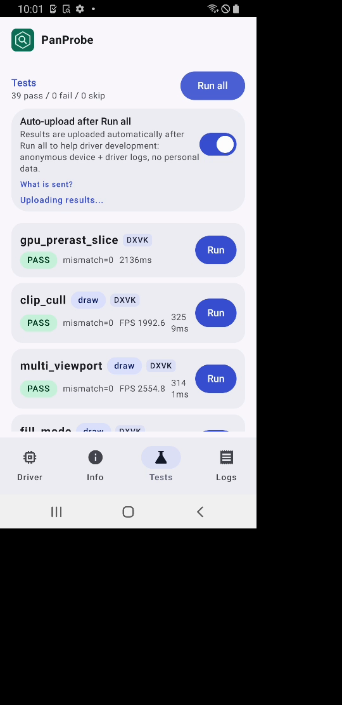

# FTL starlte (v6, Mali-G72) RC5-universal-113

AUTORUN DONE pass=39 fail=0 skip=0. Driver PanVK-kbase RC5-universal-113 (git-6b925d3100), so 48a548e4. No DEVICE_LOST, event=0x or fatal signals in logcat.

230 and 231 are v10+ only, so this run is a control. No regression on v6 JM:
- gs_tess_primitive_id passes, including the 600-patch chunk cases that fail on 113 on panther and shiba.
- tess_perf hashes match 112 for all 18 BENCH lines (4807f3f5, a03404c5, cec55885, d4463b35, b34a251c).
- No "panvk: device TLS" line is logged, as expected on JM.
- Total 296 s vs 295 s on 112. tess_perf 98.6 s vs 98.4 s, with every GPU-bound BENCH case within 0.3% (gs=0 L=16 2266 ms vs 2262 ms). bc_perf 38.6 s vs 37.9 s. large_draw 26.3 s vs 26.2 s.

Per-test durationMs (113 vs 112 on the same device model):

| test | 113 | 112 | delta vs 112 |
|---|---|---|---|
| gpu_prerast_slice | 2.1s | 2.2s | -2% |
| clip_cull | 3.3s | 3.3s | +0% |
| multi_viewport | 3.1s | 3.2s | +0% |
| fill_mode | 4.1s | 4.1s | -2% |
| bc_decode | 2.6s | 2.6s | +0% |
| bc_perf | 38.6s | 37.9s | +2% |
| tess_perf | 98.6s | 98.4s | +0% |
| geometry | 3.8s | 3.7s | +4% |
| tessellation | 6.1s | 5.8s | +5% |
| xfb | 3.4s | 3.3s | +3% |
| pipeline_stats | 3.4s | 3.3s | +1% |
| vertex_stores | 2.2s | 2.2s | +1% |
| gs_viewport_depth | 2.2s | 2.2s | +1% |
| vs_viewport_index | 2.3s | 2.4s | -3% |
| depth_bounds | 2.4s | 2.4s | -1% |
| large_draw | 26.3s | 26.2s | +0% |
| vmr_secondary | 2.2s | 2.2s | -1% |
| tess_cond_state | 2.2s | 2.2s | +1% |
| bachata_reqs | 2.1s | 2.2s | -3% |
| bachata_exec | 2.2s | 2.2s | -1% |
| robustness2 | 2.2s | 2.2s | +0% |
| robust_image_access2 | 2.9s | 2.9s | -1% |
| blend | 2.2s | 2.2s | +0% |
| occlusion_query | 2.2s | 2.2s | -1% |
| descriptor_model | 2.1s | 2.2s | -3% |
| shader_arith | 2.3s | 2.2s | +4% |
| depth_stencil | 2.2s | 2.2s | +1% |
| sampler | 2.3s | 2.2s | +2% |
| draw_params | 2.2s | 2.2s | +0% |
| submit_stress | 32.1s | 32.1s | +0% |
| csf_event | 2.9s | 2.8s | +1% |
| gs_tess_primitive_id | 2.6s | 2.6s | +0% |
| bachata_storage_fmtless | 2.2s | 2.2s | -1% |
| bachata_dynamic_render | 2.2s | 2.1s | +2% |
| dxvk_reqs | 2.1s | 2.1s | -2% |
| vkd3d_reqs | 2.1s | 2.2s | -3% |
| vkd3d_heap | 2.4s | 2.5s | -4% |
| vkd3d_timeline | 2.3s | 2.3s | +0% |
| swapchain_lifecycle | 11.4s | 11.4s | +0% |
| total | 296s | 295s | +0% |

Raw files in raw/ (the uploaded APK is not kept).

Screenshots (frames from the FTL video):   
