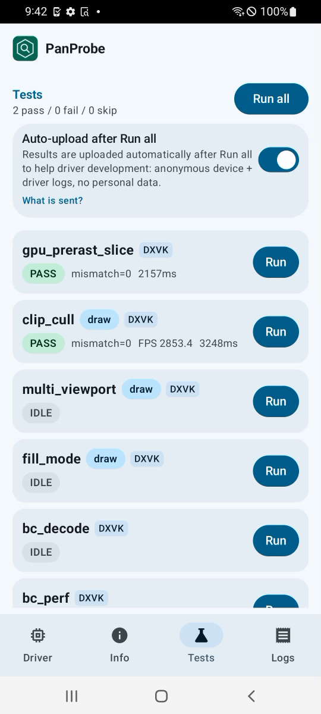
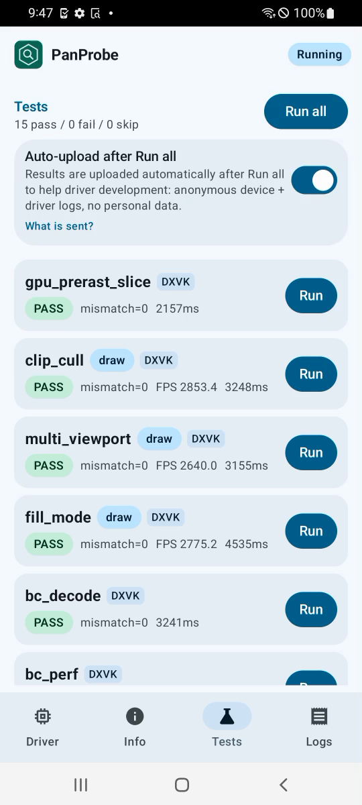
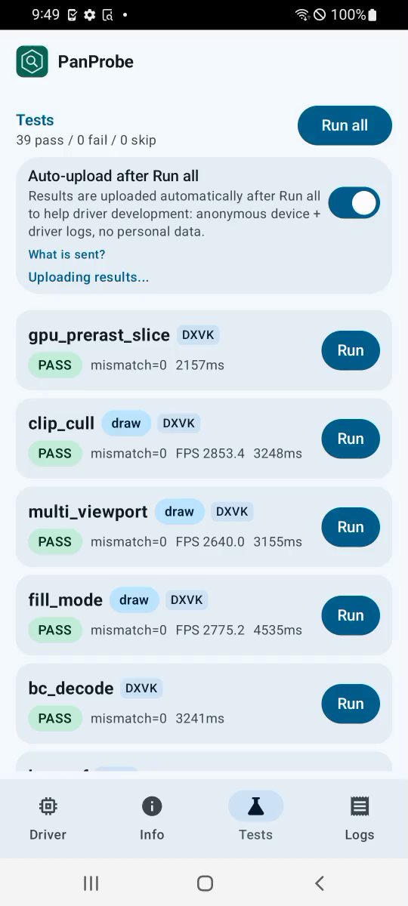

# FTL a31 (v7, Mali-G52 r1) RC5-universal-113

AUTORUN DONE pass=39 fail=0 skip=0. Driver PanVK-kbase RC5-universal-113 (git-6b925d3100), so 48a548e4. gpu_id 0x74021000 arch v7. No DEVICE_LOST, event=0x or fatal signals in logcat.

230 and 231 are v10+ only, so this run is a control. gs_tess_primitive_id passes here, including the chunk, chunk-replay and indirect-chunk cases that fail on 113 on panther and shiba. That fits a CSF-only (230/231) cause. No "panvk: device TLS" line is logged, as expected on JM. tess_perf hashes match 112 for all 18 BENCH lines (4807f3f5, a03404c5, cec55885, d4463b35, b34a251c). The driver messages are unchanged (JM atom stride 56, JIT skipped, tess batch budget 32 MiB).

## Timing: the 112 a31 slowdown was device variance

Total 364 s vs 433 s (112), 393 s (110) and 450 s (108). 108 also included about 2 s of per-test overhead on the sub-second tests. The heavy GPU tests are back to or below the 108/110 level with v7 code that is identical to 112:

| metric | 113 | 112 | 110 | 108 |
|---|---|---|---|---|
| tess_perf gs=0 L=16 | 5121 ms | 7120 ms | 5866 ms | 5120 ms |
| bc_perf BC1_RGB_UNORM A_ms | 2.98 ms | 3.55 ms | 3.30 ms | 2.98 ms |
| tess_perf test | 133.8 s | 179.9 s | 157.3 s | 139.5 s |
| large_draw | 22.9 s | 29.4 s | 23.2 s | 24.9 s |
| tessellation | 10.8 s | 13.2 s | 10.9 s | 13.0 s |

113 changes nothing on v7 JM, and the GPU-bound numbers return exactly to 108's values (5121 vs 5120 ms, 2.98 vs 2.98 ms). So the 112 slowdown came from the FTL unit's GPU clock, not from code. CPU-bound cases are flat again (submit_stress 32.1 s, swapchain_lifecycle 14.2 s vs 14.5 s).

Per-test durationMs (113 vs 112 on the same device model):

| test | 113 | 112 | delta vs 112 |
|---|---|---|---|
| gpu_prerast_slice | 2.2s | 2.4s | -10% |
| clip_cull | 3.2s | 3.6s | -9% |
| multi_viewport | 3.2s | 3.3s | -5% |
| fill_mode | 4.5s | 5.0s | -9% |
| bc_decode | 3.2s | 3.3s | -2% |
| bc_perf | 64.0s | 74.2s | -14% |
| tess_perf | 133.8s | 179.9s | -26% |
| geometry | 4.2s | 4.2s | -2% |
| tessellation | 10.8s | 13.2s | -19% |
| xfb | 3.3s | 3.6s | -9% |
| pipeline_stats | 3.4s | 3.4s | +0% |
| vertex_stores | 2.2s | 2.2s | -3% |
| gs_viewport_depth | 2.2s | 2.2s | -1% |
| vs_viewport_index | 2.5s | 2.5s | -2% |
| depth_bounds | 2.3s | 2.4s | -2% |
| large_draw | 22.9s | 29.4s | -22% |
| vmr_secondary | 2.1s | 2.1s | +0% |
| tess_cond_state | 2.2s | 2.2s | -1% |
| bachata_reqs | 2.1s | 2.1s | +0% |
| bachata_exec | 2.2s | 2.2s | -1% |
| robustness2 | 2.2s | 2.2s | -1% |
| robust_image_access2 | 5.7s | 7.1s | -20% |
| blend | 2.2s | 2.2s | -1% |
| occlusion_query | 2.2s | 2.2s | +0% |
| descriptor_model | 2.2s | 2.2s | +1% |
| shader_arith | 2.2s | 2.2s | +0% |
| depth_stencil | 2.2s | 2.2s | -1% |
| sampler | 2.2s | 2.2s | +0% |
| draw_params | 2.2s | 2.2s | +0% |
| submit_stress | 32.1s | 32.1s | +0% |
| csf_event | 2.6s | 2.6s | -1% |
| gs_tess_primitive_id | 2.6s | 2.6s | -1% |
| bachata_storage_fmtless | 2.2s | 2.2s | -1% |
| bachata_dynamic_render | 2.1s | 2.2s | +0% |
| dxvk_reqs | 2.1s | 2.1s | +0% |
| vkd3d_reqs | 2.1s | 2.1s | +1% |
| vkd3d_heap | 2.4s | 2.4s | -2% |
| vkd3d_timeline | 2.3s | 2.3s | +0% |
| swapchain_lifecycle | 14.2s | 14.5s | -2% |
| total | 364s | 433s | -16% |

Raw files in raw/ (the uploaded APK is not kept).

Screenshots (frames from the FTL video):   
