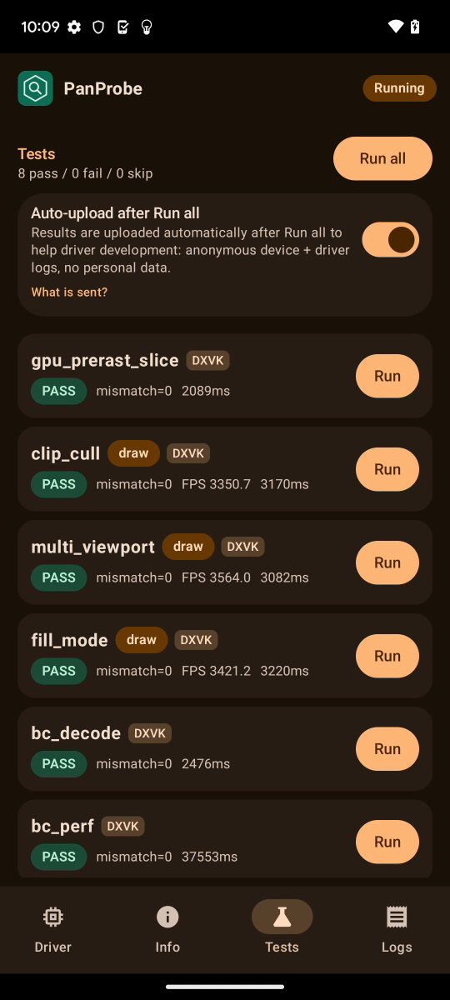
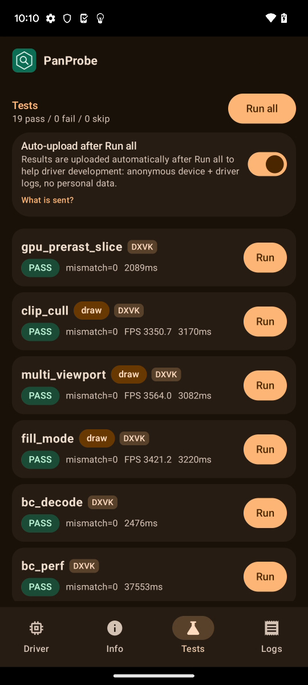
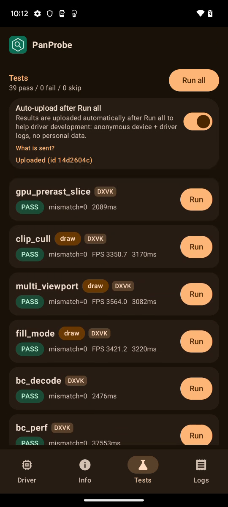

# FTL oriole (Pixel 6, v9, Mali-G78) RC5-universal-113

AUTORUN DONE pass=39 fail=0 skip=0. Driver PanVK-kbase RC5-universal-113 (git-6b925d3100), so 48a548e4. No DEVICE_LOST, event=0x or fatal signals in logcat.

230 and 231 are v10+ only, so this run is a control. No regression on v9:
- gs_tess_primitive_id passes, including the 600-patch chunk cases that fail on 113 on panther and shiba.
- tess_perf hashes match 112 for all 18 BENCH lines (4807f3f5, a03404c5, cec55885, d4463b35, b34a251c).
- No "panvk: device TLS" line is logged, as expected.
- Total 300 s vs 302 s on 112. tess_perf 93.8 s vs 94.0 s (gs=0 L=16 894 ms vs 902 ms, gs=1 L=16 3791 ms vs 3786 ms). bc_perf 37.6 s vs 39.5 s. large_draw 34.6 s vs 34.5 s.

Per-test durationMs (113 vs 112 on the same device model):

| test | 113 | 112 | delta vs 112 |
|---|---|---|---|
| gpu_prerast_slice | 2.1s | 2.1s | +0% |
| clip_cull | 3.2s | 3.1s | +1% |
| multi_viewport | 3.1s | 3.1s | +0% |
| fill_mode | 3.2s | 3.2s | +0% |
| bc_decode | 2.5s | 2.4s | +3% |
| bc_perf | 37.6s | 39.5s | -5% |
| tess_perf | 93.8s | 94.0s | +0% |
| geometry | 3.5s | 3.5s | -1% |
| tessellation | 6.4s | 6.3s | +1% |
| xfb | 2.4s | 2.4s | +1% |
| pipeline_stats | 3.3s | 3.3s | -2% |
| vertex_stores | 2.2s | 2.2s | -2% |
| gs_viewport_depth | 2.3s | 2.3s | +0% |
| vs_viewport_index | 2.3s | 2.3s | +2% |
| depth_bounds | 2.4s | 2.4s | +3% |
| large_draw | 34.6s | 34.5s | +0% |
| vmr_secondary | 2.1s | 2.1s | +0% |
| tess_cond_state | 2.3s | 2.3s | +1% |
| bachata_reqs | 2.3s | 2.3s | +0% |
| bachata_exec | 2.1s | 2.1s | -1% |
| robustness2 | 2.1s | 2.2s | -1% |
| robust_image_access2 | 10.1s | 10.1s | -1% |
| blend | 2.2s | 2.2s | -1% |
| occlusion_query | 2.1s | 2.1s | +0% |
| descriptor_model | 2.1s | 2.2s | -2% |
| shader_arith | 2.2s | 2.2s | -2% |
| depth_stencil | 2.1s | 2.2s | -1% |
| sampler | 2.2s | 2.2s | +0% |
| draw_params | 2.2s | 2.2s | +0% |
| submit_stress | 32.1s | 32.1s | +0% |
| csf_event | 2.9s | 2.8s | +3% |
| gs_tess_primitive_id | 2.4s | 2.5s | -1% |
| bachata_storage_fmtless | 2.1s | 2.1s | -1% |
| bachata_dynamic_render | 2.1s | 2.1s | +1% |
| dxvk_reqs | 2.1s | 2.1s | +1% |
| vkd3d_reqs | 2.1s | 2.1s | +1% |
| vkd3d_heap | 2.4s | 2.4s | +0% |
| vkd3d_timeline | 2.2s | 2.3s | -4% |
| swapchain_lifecycle | 8.4s | 8.3s | +1% |
| total | 300s | 302s | -1% |

Raw files in raw/ (the uploaded APK is not kept).

Screenshots (frames from the FTL video):   
