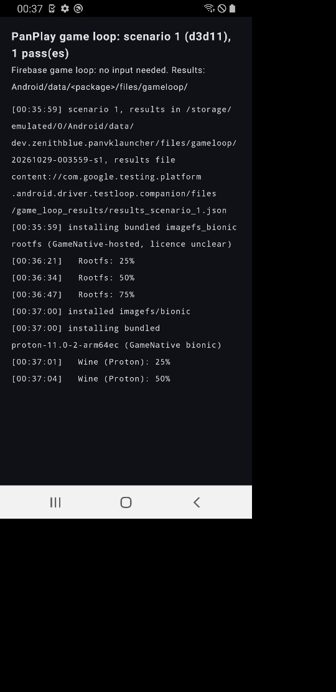
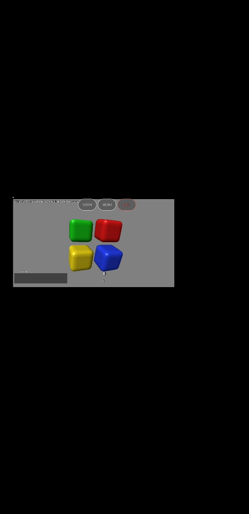
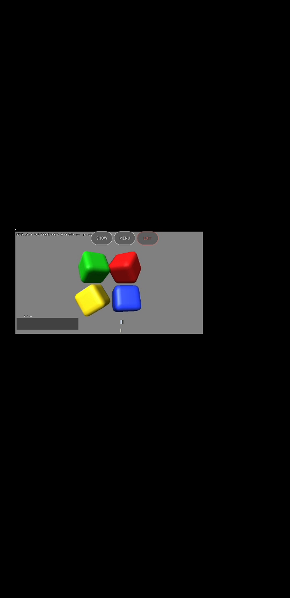
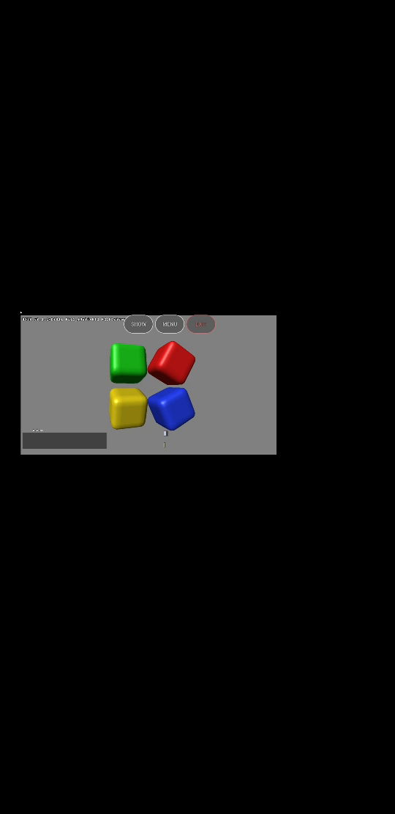
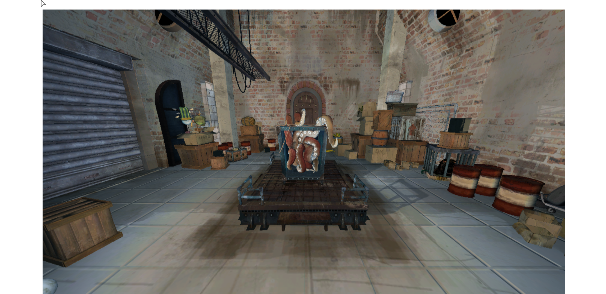
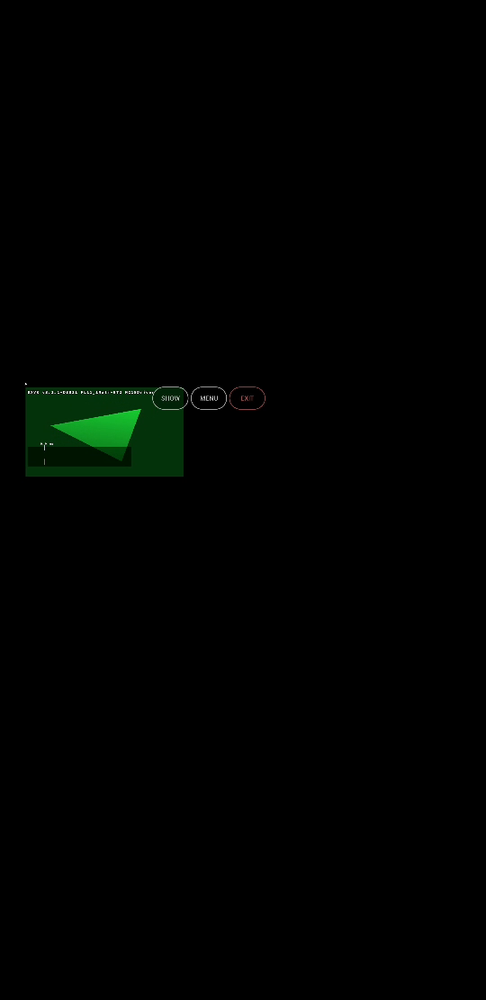
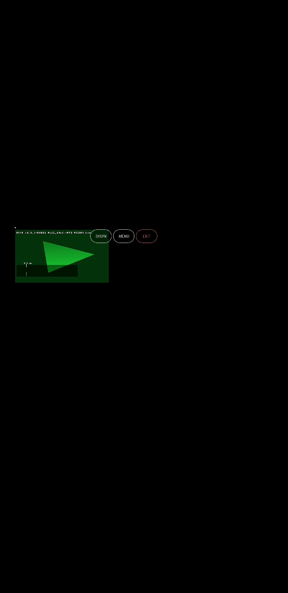

# FTL starlte (Galaxy S9 SM-G960F, Mali-G72 MP18, v6 JM, Android 10) build 118: PanPlay scenarios 1-9

- Matrix `matrix-7rs0puag3nzqa`, project `panvk-testlab`, FTL outcome `Passed starlte-29-en-portrait`, video 1443 s, run started 13:04 IST.
- APK `panplay-118.apk` (PanPlay 1.3.0 vc 44, libmemfdshim.so + CNTFRQ fix bundled), driver `Mesa 26.3.0-devel (git-a0412457ab)`.
  `gameloop-override.json`: warm-up 10 s, measure 30 s. `raw/` has everything but `video.mp4`.

## Result: 9 of 9 scenarios, 23 of 23 passes ok, no DEVICE_LOST

Fault greps (DEVICE_LOST, timeout on subqueue, GPU fault, CS_FATAL, Fatal signal, page fault): none. ("tiler heap" hits are the info line
`v6 JM, MEM_JIT_INIT skipped; tiler heap is a GROW_ON_GPF region`.) Scenario 3 d3d9 (hung in 115e-v6fix) passed.

| scn | pass | fps | test line | scenario time (s) |
|---|---|---|---|---|
| 1 | d3d11 | 102.0 | CUBE: PASS | 68 |
| 2 | d3d9 | 60.0 | CUBE: PASS | 54 |
| 3 | d3d11 / d3d9 | 87.1 / 60.0 | PASS / PASS | 107 |
| 4 | d3d11 old / default | 89.6 / 86.7 | PASS | 214 |
| 4 | d3d9 old / default | 60.0 / 60.0 | PASS | |
| 5 | D3D12 SquidRoom | 1.5 | `DX12: PASS test=d3d12-multithreading` | 56 |
| 6 | D3D12 gears | 300.1 | `DX12: PASS test=vkd3d-gears` | 53 |
| 7 | D3D12 FL 11_0 / 11_1 | 449.2 / 451.7 | PASS / PASS (created) | 276 |
| 7 | D3D12 FL 12_0 / 12_1 / 12_2 | 447.1 / 445.3 / 413.6 | UNSUPPORTED (expected on JM) | |
| 8 | D3D11 FL 10_0 / 10_1 / 11_0 / 11_1 | 78.8 / 78.4 / 78.9 / 100.3 | PASS | 323 |
| 8 | D3D10 / D3D9 cube | 101.7 / 60.0 | PASS | |
| 9 | d3d12fl_all / d3d11fl_all | 447.6 / 99.9 | DONE, D3D12 11_0+11_1 PASS, 12_x UNSUPPORTED / D3D11 10_0..11_1 PASS | 113 |

## Highest feature level

- D3D12: **11_1** (115e-v6fix: 11_1, same).
- D3D11: **11_1**.

## Compared with 115e-v6fix (`../2026-10-29-ftl-v6-starlte-115e-v6fix-panplay/`)

22/23 -> 23/23 (scenario 3 d3d9 now passes). d3d11 cube 98.9 -> 102.0 (s1), D3D12 gears 311 -> 300 (-4%), SquidRoom 1.5 unchanged,
D3D11 FL 10_0..11_0 100 -> 78.8 fps (s8, lower; 11_1 100.3 and d3d10 101.7 unchanged, so the FL 10_0..11_0 passes sit ~21% lower, same device/driver
class, not investigated, possible thermal or neighbour noise). s3/s4 d3d11 87-90 vs 99-107 before (-10..-15%).

## Screenshots

Video frames (scene + HUD) per scenario, `screenshots/starlte-118-panplay-s<N>.png`; frame time estimated from the run-id clock, s5 and s7/s8
frames can land on the neighbouring scenario (video drifts), in-app captures `screenshots/starlte-118-panplay-s<N>-app<i>-<pass>.png` are exact.

  
  
  
