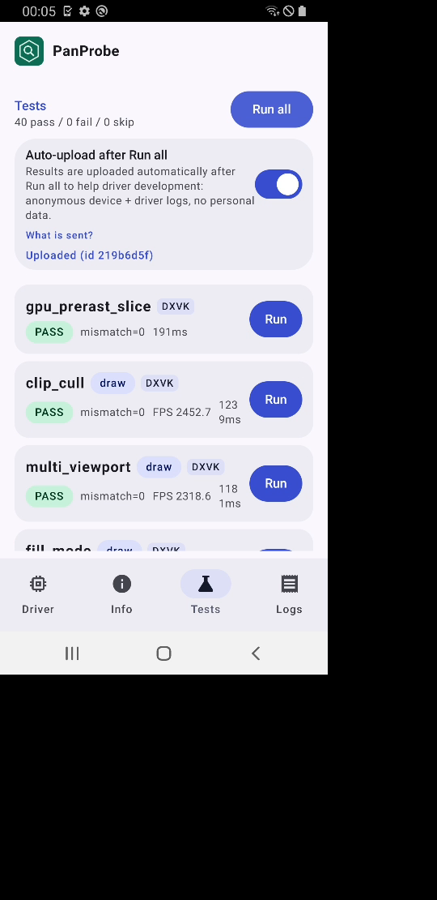

# FTL starlte (Galaxy S9 SM-G960F, Mali-G72 MP18, v6 JM, API 29) build 118: PanProbe (scenario 2, rc5 only)

- Matrix `matrix-2qhe70qeqbd44`, project `panvk-testlab`; FTL outcome `Passed starlte-29-en-portrait`, test time 176 s.
- APK `panprobe-118.apk`, rc5 slot `driverInfo Mesa 26.3.0-devel (git-a0412457ab)` (build 118, jm-v7-wip through 0153). `raw/` has everything but `video.mp4`.

## Result

- `AUTORUN DONE pass=40 fail=0 skip=0 total=40`; DEVICE_LOST occurrences in logs: 0.
- Non-PASS RESULT lines: none
- `d3d_fl` (highest = last ok level):
  - HARD ok D3D12 FL11_0
  - SOFT ok D3D12 FL11_1
  - SOFT missing D3D12 FL12_0 -- TiledResourcesTier >= 2 (have 0)
  - SOFT missing D3D12 FL12_1 -- ROVsSupported, ConservativeRasterizationTier >= 1
  - SOFT missing D3D12 FL12_2 -- VPAndRTArrayIndexFromAnyShaderFeedingRasterizer, CopyQueueTimestampQueriesSupported, ConservativeRasterizationTier 3 (hav
  - SOFT ok D3D11 FL9_1-9_3
  - SOFT ok D3D11 FL10_0-10_1
  - HARD ok D3D11 FL11_0
  - SOFT ok D3D11 FL11_1
  - SOFT missing D3D11 FL12_0 -- TiledResourcesTier >= 2 (have 0)
  - SOFT missing D3D11 FL12_1 -- ConservativeRasterizationTier >= 1, ROVsSupported

## Compared with earlier runs of this device

- 2026-10-29-ftl-v6-starlte-115c-panprobe: 40 PASS of 40 (driver git-30c29c0175)
- 2026-10-29-ftl-v6-starlte-115e-panprobe: 40 PASS of 40 (driver git-e7d836d5a6)

## Screenshots

