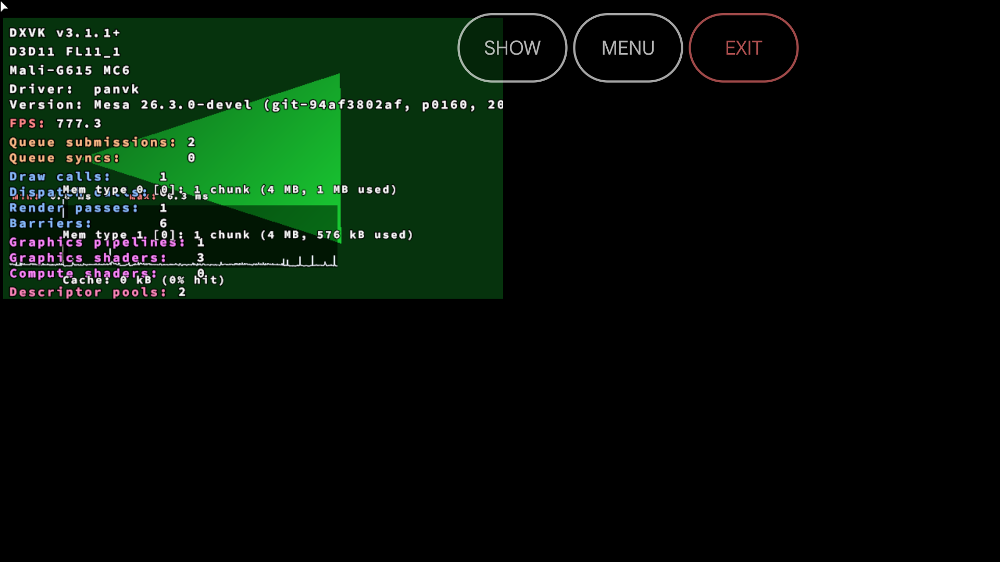
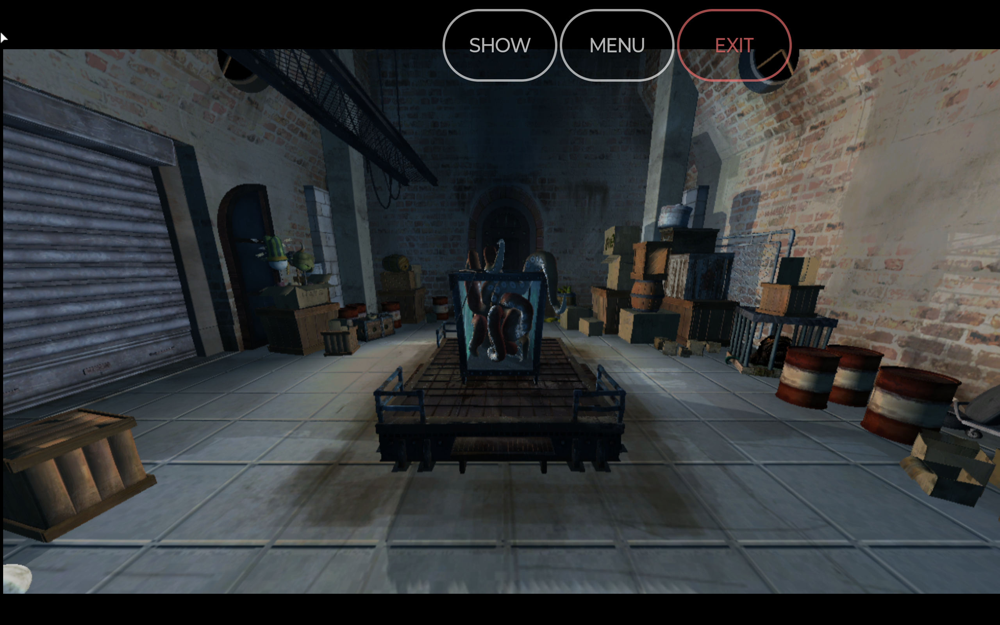
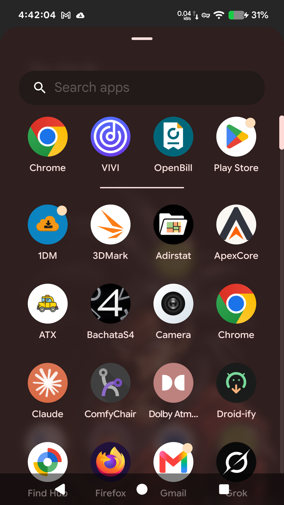
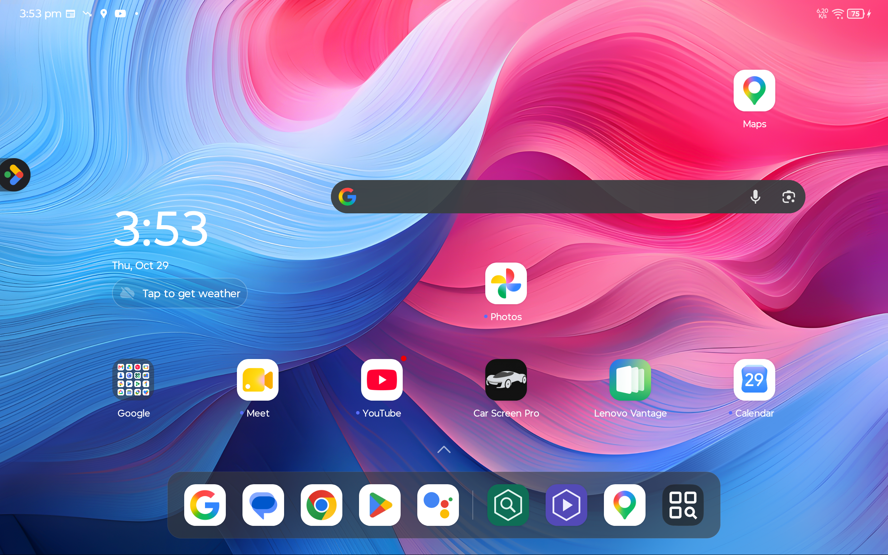

# Build 120 local regression (2026-10-29): X6 Pro (v11) and TB336FU (v9)

Driver: build 120, `Mesa 26.3.0-devel (git-94af3802af, p0160, 2026-10-29)`. .so sha256 `1195a047...`, BuildID
`6c106131...`.

APKs:
- `/var/tmp/panvk/build-out/apks/panprobe-120.apk` (`c28193ca...`)
- `/var/tmp/panvk/build-out/apks/panplay-120.apk` (`ddcff1c8...`, components bundled, MangoHud included, SquidRoom)

## PanProbe

| Device | Build | Run | Result | DEVICE_LOST |
|---|---|---|---|---|
| X6 Pro | 120 | cold | 41/41 | 0 |
| X6 Pro | 120 | warm | 41/41 | 0 |
| TB336FU | 120 | run 1 | 41/41 | 0 |
| TB336FU | 120 | run 2 | 41/41 | 0 |
| TB336FU | rc4 | | 39/41 | |

TB336FU rc4 fails `tess_perf` and `large_draw`. That is known.

The X6 Pro `*-2` runs of 116/118/120 were discarded. The tiler-OOM agent installed its own PanProbe (driver
`git-a28af6b305`) between them. The warm runs (`-w`) reinstall our APK first.

## PanPlay

Full suite, scenarios 1-9, on rc4 and 120 on both devices. Short window: 10 s warm-up, 30 s measured, config
`raw/suite.json`.

| Device | rc4 | 120 |
|---|---|---|
| X6 Pro | D3D12 scenarios fail (s5, s6, s7, s9 `d3d12fl_all`) | all pass, no DEVICE_LOST |
| TB336FU | D3D12 scenarios fail | all pass, no DEVICE_LOST |

The fps tables are in `docs/PERF-PROGRESS.md`, section "Build 120". The raw files are:
- `raw/<dev>-play-<drv>-<run>-results.txt`
- memory per pass in `raw/<dev>-play-<drv>-mem/`

## Screenshots

- PanProbe: `shots/<device>-<build>-panprobe-s2-<run>.png`
- PanPlay: `shots/<device>-<build>-panplay-s<N>[-k].png`, one per test process

For example:  
 
