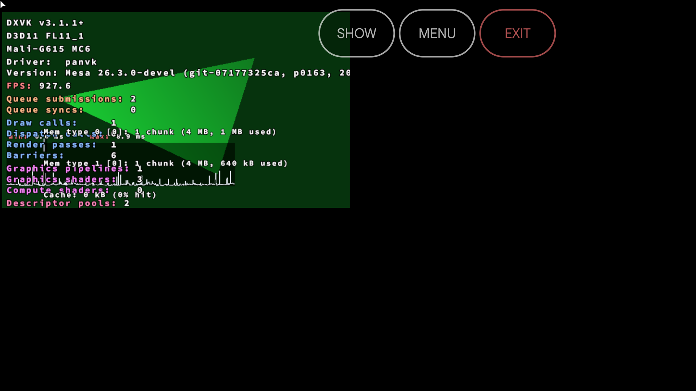
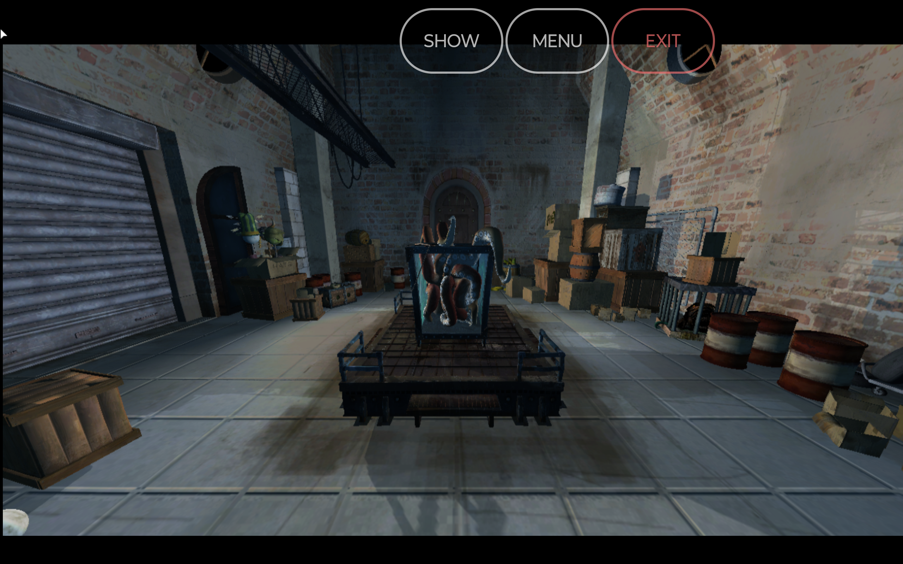

# Build 121b PanPlay full suite (2026-10-29): X6 Pro (v11) and TB336FU (v9)

Driver: build 121b = jm-v7-wip 0006-0163, `Mesa 26.3.0-devel (git-07177325ca, p0163, 2026-10-29)`, BuildID `c5337130bf092b76764921dc321808a88f56df0c` (verified inside the APK), .so sha256 `9f58ee27ad8e...`.

APK: `/var/tmp/panvk/build-out/apks/panplay-121b.apk` (sha256 `4cccfc49ea49...`), built like `apks-120.sh` (`raw/apks-121b.sh`), installed with `adb install -r` (update).

Run: `play-cfg.sh` + `b120/suite.json` (10 s warm-up, 30 s measured), scenarios 1-9, under the device flock; same config as the build 120 run.

Columns: fps = drv-fps, 1% low = dxvk 1%-low fps (blank for D3D12), PSS = max app TOTAL PSS per scenario (MB). 120 and rc4 fps come from `/var/tmp/panvk/r120` (the build 120 regression run).

## X6 Pro (v11)

| Scn | Task | Result | fps 121b | 1% low | PSS MB | fps 120 | vs 120 | fps rc4 |
|---|---|---|---|---|---|---|---|---|
| s1.1 | d3d11 | ok | 272.0 | 73.2 | 261 | 287.2 | -5 % | - |
| s2.1 | d3d9 | ok | 116.8 | 33.4 | 295 | 115.6 | +1 % | - |
| s3.1 | d3d11 | ok | 281.0 | 87.5 | 289 | 275.8 | +2 % | - |
| s3.2 | d3d9 | ok | 115.6 | 31.1 | 289 | 115.0 | +1 % | - |
| s4.1 | d3d11 | ok | 275.3 | 75.0 | 295 | 276.7 | -1 % | - |
| s4.2 | d3d11 | ok | 270.0 | 75.0 | 295 | 279.6 | -3 % | - |
| s4.3 | d3d9 | ok | 113.1 | 32.0 | 295 | 116.3 | -3 % | - |
| s4.4 | d3d9 | ok | 111.6 | 28.6 | 295 | 117.9 | -5 % | - |
| s5.1 | d3d12 | ok | 66.9 | - | 298 | 59.0 | +13 % | - |
| s6.1 | d3d12gears | ok | 207.4 | - | 294 | 174.0 | +19 % | - |
| s7.1 | d3d12fl_11_0 | ok | 143.8 | - | 270 | 198.1 | -27 % | - |
| s7.2 | d3d12fl_11_1 | ok | 215.0 | - | 270 | 207.1 | +4 % | - |
| s7.3 | d3d12fl_12_0 | ok | 230.6 | - | 270 | 210.3 | +10 % | - |
| s7.4 | d3d12fl_12_1 | ok | 231.8 | - | 270 | 166.2 | +39 % | - |
| s7.5 | d3d12fl_12_2 | ok | 213.8 | - | 270 | 178.8 | +20 % | - |
| s8.1 | d3d11fl_10_0 | ok | 699.8 | 93.9 | 324 | 744.1 | -6 % | - |
| s8.2 | d3d11fl_10_1 | ok | 754.2 | 119.8 | 324 | 738.6 | +2 % | - |
| s8.3 | d3d11fl_11_0 | ok | 922.2 | 141.1 | 324 | 751.9 | +23 % | - |
| s8.4 | d3d11fl_11_1 | ok | 776.5 | 110.2 | 324 | 706.2 | +10 % | - |
| s8.5 | d3d10 | ok | 270.5 | 67.5 | 324 | 272.1 | -1 % | - |
| s8.6 | d3d9 | ok | 112.3 | 33.4 | 324 | 117.0 | -4 % | - |
| s9.1 | d3d12fl_all | ok | 193.7 | - | 240 | 197.5 | -2 % | - |
| s9.2 | d3d11fl_all | ok | 802.7 | 122.5 | 240 | 772.2 | +4 % | - |

## TB336FU (v9)

| Scn | Task | Result | fps 121b | 1% low | PSS MB | fps 120 | vs 120 | fps rc4 |
|---|---|---|---|---|---|---|---|---|
| s1.1 | d3d11 | ok | 158.6 | 80.6 | 349 | 159.5 | -1 % | - |
| s2.1 | d3d9 | ok | 90.0 | 51.3 | 387 | 90.0 | +0 % | - |
| s3.1 | d3d11 | ok | 166.1 | 92.7 | 363 | 165.9 | +0 % | - |
| s3.2 | d3d9 | ok | 90.0 | 49.6 | 363 | 90.0 | +0 % | - |
| s4.1 | d3d11 | ok | 163.4 | 84.9 | 409 | 164.8 | -1 % | - |
| s4.2 | d3d11 | ok | 165.2 | 91.7 | 409 | 162.9 | +1 % | - |
| s4.3 | d3d9 | ok | 89.9 | 50.1 | 409 | 89.9 | +0 % | - |
| s4.4 | d3d9 | ok | 89.9 | 50.8 | 409 | 89.9 | +0 % | - |
| s5.1 | d3d12 | ok | 22.9 | - | 383 | 24.8 | -8 % | - |
| s6.1 | d3d12gears | ok | 222.6 | - | 356 | 226.4 | -2 % | - |
| s7.1 | d3d12fl_11_0 | ok | 483.0 | - | 374 | 477.0 | +1 % | - |
| s7.2 | d3d12fl_11_1 | ok | 487.5 | - | 374 | 504.3 | -3 % | - |
| s7.3 | d3d12fl_12_0 | ok | 466.9 | - | 374 | 479.5 | -3 % | - |
| s7.4 | d3d12fl_12_1 | ok | 464.4 | - | 374 | 471.9 | -2 % | - |
| s7.5 | d3d12fl_12_2 | ok | 457.1 | - | 374 | 527.4 | -13 % | - |
| s8.1 | d3d11fl_10_0 | ok | 201.7 | 98.5 | 383 | 217.0 | -7 % | - |
| s8.2 | d3d11fl_10_1 | ok | 200.0 | 100.8 | 383 | 214.4 | -7 % | - |
| s8.3 | d3d11fl_11_0 | ok | 202.1 | 102.9 | 383 | 204.5 | -1 % | - |
| s8.4 | d3d11fl_11_1 | ok | 199.8 | 95.8 | 383 | 198.8 | +1 % | - |
| s8.5 | d3d10 | ok | 163.5 | 76.1 | 383 | 157.2 | +4 % | - |
| s8.6 | d3d9 | ok | 90.0 | 49.5 | 383 | 89.9 | +0 % | - |
| s9.1 | d3d12fl_all | ok | 483.9 | - | 372 | 498.4 | -3 % | - |
| s9.2 | d3d11fl_all | ok | 197.7 | 97.7 | 372 | 192.9 | +2 % | - |

## Verdict

- PanPlay 1-9 on 121b: every task `ok`, `"deviceLost": false` in every run, on both devices.
- GPU reset: no `gpu reset` / `GPU hang` / `VK_ERROR` / `fault` lines in logcat of any scenario (`raw/<dev>/logcat-filtered.txt` is empty). X6 Pro dmesg only shows the usual `mali: Unknown ioctl 0xc010640c` noise; TB336FU dmesg is not readable over adb shell (0 lines).
- Regression vs 120: none outside noise (30 s window, one run each). X6 Pro D3D12 FL tasks (s7) swing between runs: s7.1 `d3d12fl_11_0` -27 % (143.8 vs 198.1), s7.2-5 +4 to +39 %; s9 `d3d12fl_all` -2 %. D3D11/D3D10/D3D9 tasks are within -6 %..+23 % on X6 Pro and -7 %..+4 % on TB336FU; TB336FU worst is s7.5 `d3d12fl_12_2` -13 %, s5 d3d12 multithreading -8 %. Rerun s7 on the X6 Pro if the -27 % matters.
- 0162 (BC prewarm) and 0163 (v9 GS skip) show no PanPlay effect, as expected (no BC/GS in these scenes).

## Extra test: 0161 tiler IR vs D3D11 cube fps (X6 Pro, v11)

Coordinator request: the v13 oom2final build lost 32-39 % on D3D11 cube (s1 606 vs 965, s3 600 vs 882). Suspect: 0161 per-pass FINISH_FRAGMENT / single group. On the X6 Pro, 121b, s1 and s3, default vs `PANVK_KBASE_TILER_IR=0` (set through `env` in the game loop config, `raw/suite-ir0.json`; the env is present in each run's `config.json`). 3 alternating runs (default, IR=0, default, ...).

| Scn | Run | default fps | IR=0 fps |
|---|---|---|---|
| s1 d3d11 cube | 1 | 279.2 | 265.3 |
| s1 d3d11 cube | 2 | 281.5 | 289.3 |
| s1 d3d11 cube | 3 | 278.3 | 277.1 |
| s3 d3d11 cube | 1 | 275.6 | 281.4 |
| s3 d3d11 cube | 2 | 277.5 | 280.4 |
| s3 d3d11 cube | 3 | 278.5 | 273.1 |
| **s1 mean** | | **279.7** | **277.2** (-0.9 %) |
| **s3 mean** | | **277.2** | **278.3** (+0.4 %) |

Result: no difference on v11 (within +/- 3 %, run-to-run spread is as large as the gap). The v13 drop is **not reproduced and not attributable to TILER_IR on the X6 Pro**; the X6 Pro cube runs at about 280 fps (fragment/CPU limited, 3.5 ms per frame) so a 0.3 ms per-frame cost would show up as about -8 %, and it does not. Needs the test on v13 itself to confirm.

Raw: `raw/ir/<def|ir0>-<n>/` (summary + results per run).

## Raw files and screenshots

- `raw/<x6|tb>/summary.txt`, `mem/s<N>[-k].txt` (PSS per pass), `<run>-s<N>/` (results, harness log, per-task json), `dmesg.txt`, `logcat-filtered.txt`.
- Shots: `shots/<x6pro|tb336fu>-121b-panplay-s<N>[-k].png`, one per test process (at least one per scenario per device). E.g.  
