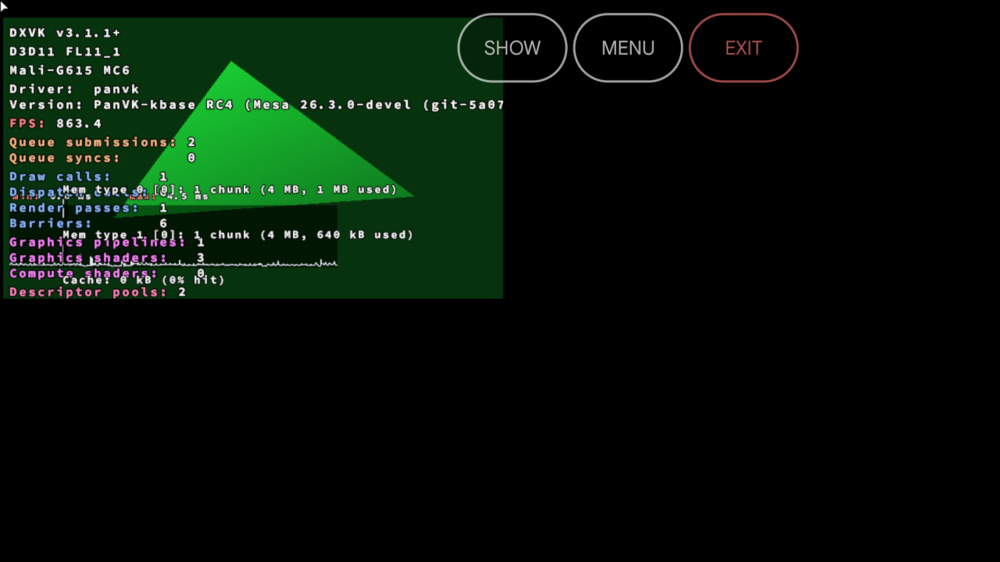
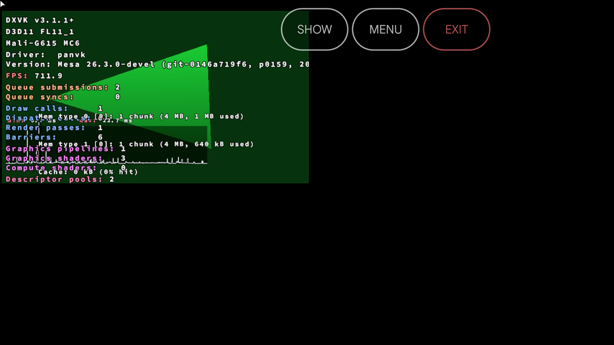

# X6 Pro (v11): rc4 vs 119 PanPlay fps gap (2026-10-29)

Question: D3D11 FL tests ran 700-800 fps on rc4 and about 300 on 119 (s8 `20261029-134524` rc4 vs
`20261029-132348` 119). Cause found and fixed in **jm-v7-wip 0160** (build 120).

Method: one APK (panplay-119), drivers installed per env set with the game loop `installDrivers` option, so every
driver runs in the same session, window (10 s warm-up, 30 s measured) and thermal state. No `PANVK_MEM_LOG`,
no `PANVK_GPU_STATS`. Configs `raw/ab*.json`, runner `raw/play-cfg.sh`, results `raw/ab*-results.txt`.
rc4 has no driver fps log, so the table uses DXVK HUD fps (`dxvk-fps`); `1%-low` is the HUD 1 % low.

## Cause

jm-v7-wip **0115** (`PANVK_WSI_SW_CACHED`, in every build since 115c): PanPlay presents through the X11 sw WSI
(kbase, no DRI3 dma-buf), which reads every frame back on the CPU. 0115 reads it through the cached memory type
and runs a userland DC CIVAC over the whole frame before each read. On this SoC that invalidate costs more than
the write-combined read it replaces, about +1.8 ms per present at 640x360. Small frames (the FL tests: clear and
one triangle) hit that floor. rc4 predates 0115 and reads uncached.

Not the cause:
- Measurement overhead: the 119 runs without the memory log or the GPU stats file are just as slow (ab1, ab2).
- Builds 115c-119: they are equal to each other (ab1).
- Android present knobs: they have no effect beyond run-to-run noise (ab2). PanPlay does not present through
  PanVK's ANativeWindow swapchain, and no `post_*` timing lines appear.
- rc4 skipping work: the screenshots show the same rendered frames.

## A/B (dxvk-fps / 1%-low / drawn %)

| Run | Task | rc4 | 115c | 116 | 119 | 119 `SW_CACHED=0` |
|---|---|---|---|---|---|---|
| ab1 | FL 10_0 | 837 / 161 / 53 | 289 / 41 / 59 | 283 / 47 / 60 | 310 / 46 / 59 | |
| ab1 | FL 11_1 | 803 / 132 / 54 | 381 / 52 / 59 | 340 / 48 / 59 | 396 / 52 / 59 | |
| ab3 | FL 10_0 | 778 / 123 / 57, again 832 / 148 / 54 | | | 288 (diag env), 323 (`DEFER_REPLY=0`) | **800 / 144 / 54** |
| ab4 | FL 11_1 | | | | 257 / 41 / 60, again 385 / 48 / 59 | **834 / 155 / 53** |
| ab4 | cube d3d11 | | | | 257 / 43 / 52 | **271 / 83 / 56** |
| ab4 | D3D12 SquidRoom (drv fps) | | | | 58.1, again 55.8 | 57.6 |
| ab2 | cube d3d11 | 296 / 87 / 56 | | | 289 / 50 / 51 | |

ab2 Android present knobs on 119 (FL 10_0 / cube): default 335 / 289, `PANVK_ANDROID_PRESENT_THREAD=0` 272 / 213,
plus `PANVK_ANDROID_PRESENT_FENCE=0` 290 / 204. The later passes run hotter, which accounts for these
differences. No knob comes close to rc4.

`drawn` is the compositor's rate. The display runs at about 60 Hz, so a few % lower drawn with 800 fps means
more frames are dropped between composites. It does not mean fewer frames are shown.

ab4 pass 3 (cube, 119 again) exited at launch with Wine exit 5 after 4 s. That is a harness start flake, not a
driver result.

## Fix

0160: `sw_cached_noncoherent` defaults off. `PANVK_WSI_SW_CACHED=1` turns the cached read + invalidate back on
for A/B. With it off, FL 11_1 goes from 257-385 to 834 fps, which equals rc4 (803). The cube goes from 257 to
271 fps, and its 1 % low from 43 to 83. SquidRoom is unchanged. No correctness cost: the write-combined read is
the rc4 path, and the GPU-side barrier is unchanged.

The Firebase starlte (v6) drop between 115e and 118 is a separate issue. 0115 is already in 115e, so this does
not explain it.

## Screenshots

Each ab run has one screenshot per pass, in pass order. In ab4 the failed pass 3 has none, so from `-3` on the
ab4 numbering runs one pass behind.

- ab1:  [2](shots/x6pro-ab1-panplay-s10-2.png) [3](shots/x6pro-ab1-panplay-s10-3.png) [4](shots/x6pro-ab1-panplay-s10-4.png) [5](shots/x6pro-ab1-panplay-s10-5.png) [6](shots/x6pro-ab1-panplay-s10-6.png) [7](shots/x6pro-ab1-panplay-s10-7.png) [8](shots/x6pro-ab1-panplay-s10-8.png)
- ab2: [1](shots/x6pro-ab2-panplay-s10.png) [2](shots/x6pro-ab2-panplay-s10-2.png) [3](shots/x6pro-ab2-panplay-s10-3.png) [4](shots/x6pro-ab2-panplay-s10-4.png) [5](shots/x6pro-ab2-panplay-s10-5.png) [6](shots/x6pro-ab2-panplay-s10-6.png) [7](shots/x6pro-ab2-panplay-s10-7.png) [8](shots/x6pro-ab2-panplay-s10-8.png)
- ab3: [1](shots/x6pro-ab3-panplay-s10.png) [2](shots/x6pro-ab3-panplay-s10-2.png) [3](shots/x6pro-ab3-panplay-s10-3.png)  [5](shots/x6pro-ab3-panplay-s10-5.png)
- ab4: [1](shots/x6pro-ab4-panplay-s10.png) [2](shots/x6pro-ab4-panplay-s10-2.png) [3](shots/x6pro-ab4-panplay-s10-3.png) [4](shots/x6pro-ab4-panplay-s10-4.png) [5](shots/x6pro-ab4-panplay-s10-5.png) [6](shots/x6pro-ab4-panplay-s10-6.png) [7](shots/x6pro-ab4-panplay-s10-7.png) [8](shots/x6pro-ab4-panplay-s10-8.png)
